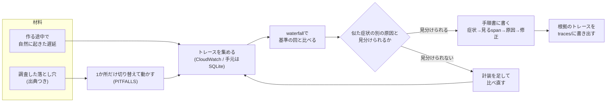
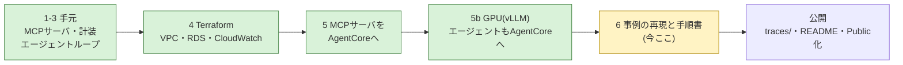
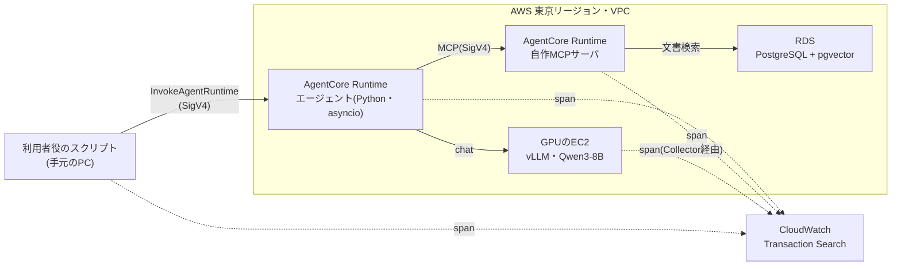
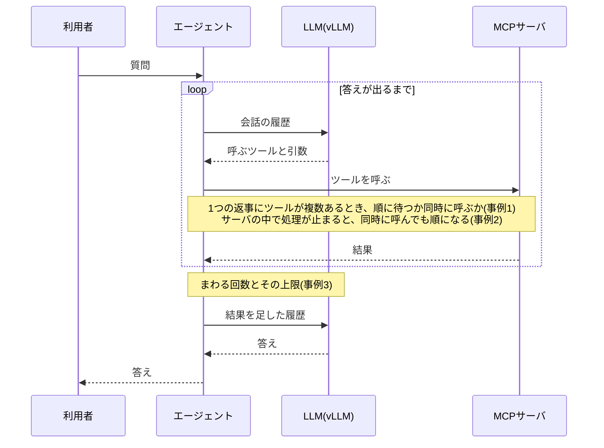

# agent-latency-tracer ― AIエージェントの遅延を、トレースから原因まで切り分ける手順書を作る

LLM・MCP経由のツール・RAGを持つPython製のAIエージェントをAWS上に組み、踏みがちな遅延を再現して、
**どのspan・属性を見れば原因を見分けられるか**を確かめるプロジェクト。エージェントとMCPサーバはAmazon Bedrock AgentCore Runtime、
LLMはGPUのEC2上のvLLM(Qwen3-8B)、検索はRDS(pgvector)に置き、OpenTelemetryで基盤側も含めて1本のトレースにつなぐ。

> 運用改善の実績ではない(トラフィックは合成)。落とし穴の一部はわざと入れたもので、計装と手順書を確かめるための障害の注入にあたる。
> 作る途中で自然に起きて突き止めたものは、「自然に発生」と分けて書く。



---

## 今どこまで進んだか



| 段階6の作業 | 状態 |
|---|---|
| 自然に起きた件(設計書§7)を手順書の項目にする | 済(2026-11-04、6項目) |
| 落とし穴の切り替え(#1・#2・#3)と、Runtimeへの渡し方(Terraformの変数`pitfalls`) | 済 |
| 事例ごとの質問、同時に投げる口 | 済(PR #19) |
| 回の条件をそろえる(セッションを温めてから測る)、回数と順番 | 済(2026-11-05) |
| GPUの1回目: 基準の回 → #12 待ち行列(同時6問) → #1 → #2 → #3 → 基準の確認 | 済(2026-11-05、GPU約1時間20分)。結果は[手順書](docs/runbook.md) |
| GPUの2回目: 5・M1・M4・10 | これから(1回目の後に、紛らわしい組み合わせに絞るかを見直す) |

---

## 症状から引く表(手順書の入口)

遅いとき、waterfallの見え方からこの表を引き、[手順書](docs/runbook.md)の該当する項目へ進む。「予想」はまだ確かめていない行。

| waterfallでの見え方 | 考えられる原因 | 見分ける手がかり | 状態 |
|---|---|---|---|
| ツールのspanが階段状に並ぶ | #1 逐次await / #2 asyncの中のブロッキング | #1はエージェント側の`execute_tool`の開始が階段状。#2はエージェント側の開始がそろい、サーバ側の`POST /mcp`・`tools/call`の開始が階段状 | 確認済み |
| `MCP send`がサーバの`tools/call`より長い | 計装の保存がイベントループを止める / 通信 | `POST /mcp`の中か、計装をオフにすると消えるか | 確認済み |
| `MCP send`と`tools/call`の始まりの間に隙間 | サーバの内部の`tools/list` | HTTPの層のspan | 確認済み |
| MCPの呼び出しが毎回5〜7秒かかる | M2 毎回のコールドスタート | 基盤側のspanの`session.id`が毎回違うか | 確認済み |
| chatのTTFTが長い | #8 長い入力 / ツール名のパーサ待ち | `vllm.time_to_first_token_ms`(サーバ側)も長いか | パーサ側は確認済み |
| chatが長いがTTFTは短い | #9 長い出力 / 止まらない生成 | `output_tokens`・`finish_reasons` | 確認済み(2B) |
| chatの回数が多い | #3 同じツールの繰り返し / ツール呼び出しの外れ(項目名の推測など) | 同じツール・引数を繰り返しているか、`invoke_agent`の`error.type`が`max_turns_exceeded`か。外れは、最初の`execute_tool`の`error.type`が`tool_error` | 繰り返しは注入では起きず自然に1回。外れは8Bで25回中23回 |
| 同時に来た質問でだけ遅い | #12 推論サーバの待ち行列 | 待ち行列の時間(vLLMの`llm_request` spanと応答の本文) | 同時6問では待ち0 |
| 呼び出し側は1回なのに、基盤側の`AgentCore.Runtime.Invoke`が同じセッションで2つ並ぶ | クライアントのタイムアウトと自動再送 | 手元の`InvokeAgentRuntime`の数と、基盤側の数 | 確認済み(自然に発生) |
| 新しいセッションの最初の検索だけ、7〜8秒かかるか失敗する | 割り当ての前に作ったDBの接続が切れている | `tools/call`の中で`SELECT documents`が始まるまでの空き、MCPサーバのログの`connection failed check` | 確認済み(自然に発生)・修正の確かめは未 |
| 最初の1問だけ遅い | 原因未確認 | `llamacpp.prompt_ms` ÷ `prompt_n` | 原因未確認 |
| 文書検索のspanが数百ms | #5 インデックスが無い | `SELECT documents`のspan | 確認済み |

---

## 構成



矢印は通信をかける向き。通信はすべてエージェントからかけ、何をするかはLLMが決める。1問の流れは次のとおり。



1問のトレースは、手元から最下層まで1本につながる(2026-11-03に確認)。

```
InvokeAgentRuntime(手元)
└ AgentCore.Runtime.Invoke(エージェントの基盤)
  └ invoke_agent
    ├ chat → llm_request(vLLM)
    └ execute_tool → MCP send
                     └ AgentCore.Runtime.Invoke(MCPサーバの基盤)
                       └ POST /mcp → tools/call retrieve_documents → SELECT documents
```

| 部品 | 実装 | 補足 |
|---|---|---|
| エージェント | Python・asyncio | LLMがツールを選んで呼び、結果を見て次を決めるループ |
| LLM | vLLM(OpenAI互換)・Qwen3-8B。開発中は手元のllama.cpp・Qwen3.5-2B | CPUの2BではLLMが時間のほとんどを占め、ほかの遅れが埋もれるので、再現はGPUで行う |
| ツール | 自作のMCPサーバ(公式Python SDKの低レベルAPI、Streamable HTTP) | 業務ツール4つ(汎用型、モックは200〜800ms待って合成データを返す)と文書検索 |
| 計装 | OpenTelemetry(GenAI規約・MCP規約) | トレースの文脈はMCPの`params._meta.traceparent`とHTTPヘッダで渡す。サーバ側の計装はオフにもできる(計装の無いサーバを想定) |
| インフラ | Terraform | 使うときに作り、終わったら消す |

---

## 用語

| 用語 | 意味 |
|---|---|
| span / トレース | 処理1つの開始と終了の記録 / 1つの質問に属するspanの木 |
| waterfall | spanを時間の横棒で並べた図。待ちや直列が見える |
| 基盤側のspan | AgentCoreが出すspan(`AgentCore.Runtime.Invoke`)。自分のコードの外の時間が分かる |
| TTFT | 最初のトークンが届くまでの時間。クライアント側とvLLM側で別に記録する |
| 落とし穴の切り替え | 環境変数`PITFALLS`(例: `1,2`)。各プロセスが起動時に読み、自分の側の番号だけ効く |
| 自然に発生 | わざと入れたのではなく、作る途中で起きた遅延 |

---

## 事例集

番号は[調査メモ](docs/latency-pitfalls-survey.md)の番号。

| # | 落とし穴 | 修正 | 状態 |
|---|---|---|---|
| 1 | 独立したツール呼び出しを逐次awaitする | `asyncio.gather`で並列化 | 再現済み(エージェント側が階段) |
| 2 | asyncの中のブロッキング呼び出し(MCPサーバ側) | 非同期I/O・スレッドへ逃がす | 再現済み(サーバ側が階段) |
| 3 | エージェントループの過剰反復 | 反復回数の上限 | 注入では2B・8Bとも起きず。8Bの基準の回で自然に1回 |
| M2 | MCPのセッションを使い回せず、毎回コールドスタート | `Mcp-Session-Id`を送り返す | 自然に発生・確認済み(31秒→5.6秒) |
| 5 | ベクトル検索のインデックスが無い | HNSWインデックス | 再現済み(`SELECT documents`のspanが480〜540ms→10〜12ms) |
| 12 | 同時の質問が推論サーバの待ち行列で待つ | 並行数に見合う台数・設定 | 同時6問では待ち0・preemption 0 |
| 10 | プロンプトの先頭に現在時刻を入れ、プレフィックスキャッシュが効かない | 時刻を入れない・日付だけにする | 切り替えを作った(GPUの2回目で流す) |
| M1 | データの種類ごとにツールを作り、ツール定義が膨らむ(45個・約12,900トークン。2回目は範囲の引数が無い約9,300) | 操作ごとの汎用ツールにする | 切り替えを作った(GPUの2回目で流す) |
| R・M4・8/9 | リトライ、大きなツール結果、長い入出力 | | 未着手 |

「検索を1件ずつ呼ぶ」(#6)は、HNSWありの検索が1件1msで差が出ない見込みのため外した(2026-10-31)。

**検索の実測(#5、2026-10-26)**: RDS(db.t4g.medium)、1024次元×10万件、top-5。条件は測る前に現実の値から決めた。

| | HNSWなし(全件走査) | HNSWあり |
|---|---|---|
| DBの中の実行時間(中央値) | 488ms | 1.0ms |
| p95 | 625ms | 1.5ms |

HNSWのパラメータはpgvectorの初期値のまま。recall@5は0.882(全件走査の結果を正解にした)。詳しくは[設計書](docs/DESIGN.md)の§8。
MCPサーバ経由のwaterfallでの見え方は[手順書](docs/runbook.md)の#5(2026-11-06)。

---

## 限界と範囲外

| 項目 | 言えないこと |
|---|---|
| トラフィック | 合成。実際の利用者の分布での頻度は分からない |
| 原因の範囲 | 事例集と、作る途中で遭遇したものだけ。未知の原因を見つける仕組みではない |
| 応答品質 | 測らない。安く測れるもの(#5のrecall@k)だけ測る |
| モデル・エンジン | Qwen3-8B・vLLM 0.31.0での見え方。パーサの待ちなどは版に依存する |

---

## 動かし方(手元)

AWSを使わずに、MCPサーバとエージェントを手元で動かせる(検索はfaiss、トレースは自作のSQLite保存と単一HTMLのwaterfall)。

```bash
# Linux(WindowsではWSL)で。venvは ~/.venvs/agent-latency-tracer に作り、pip install -e ".[dev]"
export TRACE_DB=~/traces/traces.db          # 測定中の書き込みが遅くならないよう、Linux側のディスクに置く
# ターミナル1: MCPサーバ(127.0.0.1:8000/mcp)。落とし穴を入れるなら PITFALLS=2 などを付ける
~/.venvs/agent-latency-tracer/bin/python -m system.mcp_server
# ターミナル2: 仮の質問をエージェントに流し、質問ごとのwaterfallをout/に出す(llama.cppを127.0.0.1:8080で起動しておく)
~/.venvs/agent-latency-tracer/bin/python scripts/run_agent.py
```

AWSでは`infra/`のTerraformで作り、`-var pitfalls=1,2`のように落とし穴を選ぶ。作り方・消し方・費用は[設計書](docs/DESIGN.md)の§6・§8。

---

## ディレクトリ構成

```
agent-latency-tracer/
├── system/            # 観測対象のエージェント
│   ├── agent.py         # エージェントループ
│   ├── pitfalls.py      # 落とし穴の切り替え(PITFALLS)
│   ├── mcp_client.py    # 計装つきMCPクライアント
│   ├── mcp_server/      # 自作MCPサーバ
│   ├── tools/           # 業務ツールの定義、合成データ、モック実行
│   ├── retrieval/       # 手元用の検索(faiss)
│   └── llm/             # OpenAI互換クライアント
├── tracing/           # 計装(span定義)と、手元用の保存・waterfall
├── scripts/           # 手元とAWSでの実行、トレースの書き出し(export_trace.py)
├── infra/             # Terraform
├── traces/            # 手順書の根拠のトレース(伏せたJSONとwaterfallのHTML、事例ごとのフォルダ)
├── tests/
└── docs/
    ├── runbook.md                 # 切り分けの手順書
    ├── DESIGN.md                  # 設計書(決定事項・次にやること・見つかったこと・実測値)
    ├── latency-pitfalls-survey.md # 事例の調査メモ(出典つき)
    └── tool-catalog-survey.md     # 業務ツールの形を決めるための調査メモ
```
