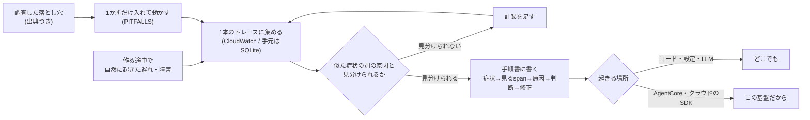
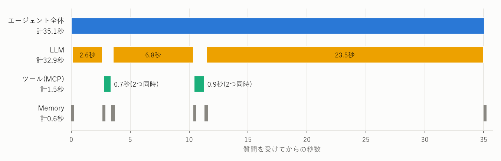
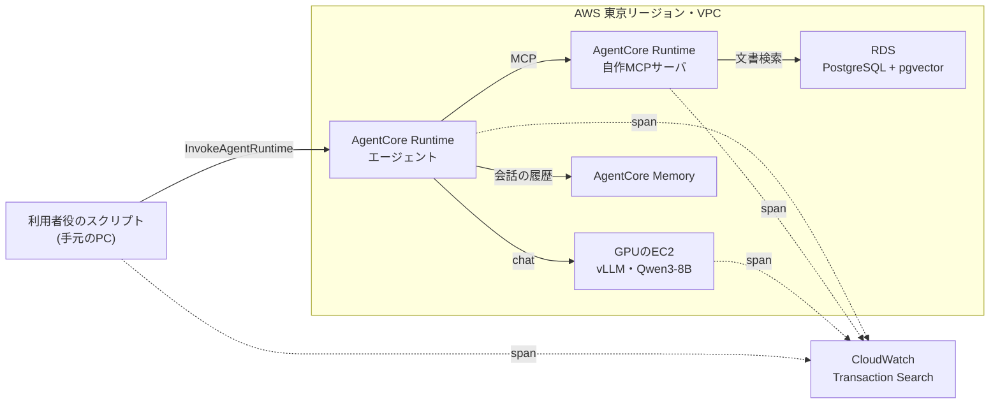

# agent-latency-tracer ― AWSの基盤に載せたAIエージェントの遅れと障害を22件切り分け、基盤の差は速さではなく壊れ方に出た

LLM(vLLM・Qwen3-8B)・自作のMCPサーバ・RAG(pgvector)を持つPython製のAIエージェントを、AWSのマネージドな基盤(Amazon Bedrock AgentCore Runtime)に載せ、
OpenTelemetryで呼び出し側から基盤・LLM・DBまでを1本のトレースにつないだ。調べた落とし穴を1つずつ入れて動かし、作る途中で自然に起きた遅れ・障害と合わせて、
**どのspan・属性を見れば原因を見分けられるか**を[切り分けの手順書](docs/runbook.md)にまとめた。各事例は、どこでも起きるか、この基盤だから起きるかで書き分けた。

> 運用改善の実績ではない(トラフィックは合成)。番号の付いた事例の多くはわざと入れた障害で、計装と手順書を確かめるためのもの。
> オンプレ側は測っておらず、「どこでも起きる」かは一般的な情報と、手元だけで動かす形(llama.cpp・faiss・SQLite)で起きたかで判断した。
> AWSの振る舞いは2026年11月時点、AgentCore Runtime V1(初期値)で確かめたもの。



---

## 結果サマリー

| 項目 | 値 |
|---|---|
| **手順書の事例** | **22件**: どこでも起きる14件、この基盤だから起きる8件(調査から選んだ事例8件、作る途中で起きたもの9件、観察5件) |
| 状態 | 修正を確かめた13件、記録だけ7件、原因が未確認2件 |
| 1問の時間(2026-11-11) | 呼び出し側で35.2秒、うちLLMの3回の呼び出しが32.9秒 |
| 基盤が足す時間 | 新しいセッションの起動0.4〜0.6秒、ツール1回の中継0.08〜0.12秒、Memoryへの書き込み1回0.07〜0.2秒 |
| 利用者が切ったとき | 直す前はエージェントが答えを最後まで作った(34.4秒)。2段の修正で、切ってから約1秒で止まる |
| DBの接続の寿命 | セッションの最後の使用から16〜21分残る。繁忙時の見積もりは約380〜500本で、上限の400を超えうる |
| 原因が未確認 | 15分以上あけた後の最初のツール呼び出し(+0.55〜0.85秒)、最初の1問だけLLMの読み込みが遅い(手元の2B) |

**ふだんの時間はLLMで決まり、基盤の差は壊れ方(切断と接続の寿命)に出た。**

| 用語 | 意味 |
|---|---|
| span / トレース | 処理1つの開始と終了の記録 / 1つの質問に属するspanの木 |
| waterfall | spanを時間の横棒で並べた図。待ちや直列が見える |
| 基盤側のspan | AgentCoreが出すspan(`AgentCore.Runtime.Invoke`)。自分のコードの外の時間が分かる |
| セッション | AgentCore Runtimeが会話ごとに割り当てる実行環境(microVM)。15分使われないと止まる |
| 見え始め | 答えの文字が見え始めるまでの時間。直すかどうかの判断に使う([方法](#方法)) |
| どこでも / この基盤だから | 起きる場所の分け方。前者はコード・設定・LLMの性質、後者はAgentCore・クラウドのSDKの都合による |

---

## 1問35.2秒のうち32.9秒はLLMで、基盤が足すのは合わせて約1秒

**呼び出し側で35.2秒かかった質問(「A社の未出荷の受注と、品目X001の在庫は?」)で、LLMの3回の呼び出しが32.9秒を占めた。**



帯はエージェント側のspanから描いた(エージェントの中は35.1秒。呼び出し側との差の約0.15秒は、基盤の中継と答えの帰り)。ツールは2つずつ同時に呼んでいる。

| 基盤が足すもの | 大きさ | いつ乗るか |
|---|---|---|
| 新しいセッションの起動 | 0.4〜0.6秒 | 会話の最初だけ |
| MCPサーバへの中継 | 0.08〜0.12秒(エージェントの`MCP send`とサーバの`tools/call`の差) | ツール1回ごと |
| Memoryへの書き込み | 1回0.07〜0.2秒(この質問で8回、計0.6秒) | メッセージごと |

この基盤に載せたこと自体が足す時間は、この質問で1問の約3%だった。ふだんの時間を縮めるのは推論サーバとモデルの側になる。
根拠: [このトレースのwaterfall](traces/base/gpu4-q2.html)、手順書の[新しいセッションの約1秒](docs/runbook.md#観察-新しいセッションでも遅れは約1秒)。

---

## 利用者が切っても答えを最後まで作り、止めるには2段の修正が要った

**呼び出し側が4秒で切っても、エージェントは35.8秒まで答えを作り、vLLMも最後まで生成した。AgentCoreの中継が切断をエージェントに伝えないためで、止める合図を送っても、サーバが処理中の要求を待ってさらに約30秒続いた。**

| 止め方 | エージェントの終わり | LLMの生成 |
|---|---|---|
| 何もしない(2026-11-09) | 35.8秒まで続けた | 最後まで |
| 切ったら`StopRuntimeSession`でセッションを止める | 34.4秒まで(合図の約30秒後) | 3回とも最後まで |
| ＋ サーバが処理中の要求を待たない(uvicornの`timeout_graceful_shutdown=0`) | 切った時刻ごろに`cancelled` | 約1秒で止まった |

1段目はこの基盤だから、2段目はuvicornの既定によるもので、どこでも起きる。既定のメトリクスには映らない(vLLM 0.31.0は切られた要求を`abort`にも数えない)。
呼び出し側とエージェントのspanが1本のトレースにつながっていて初めて見えた。
根拠: 手順書の[利用者が切っても、エージェントが答えを最後まで作る](docs/runbook.md#自然に発生-利用者が切ってもエージェントが答えを最後まで作る)、[traces/disconnect/](traces/disconnect/)。

---

## セッションが終わってもDBの接続は16〜21分残り、繁忙時は上限を超えうる

**MCPサーバのmicroVMは最後の要求から15分で、DBの接続を閉じずに止まる。RDSが生存確認で気づくまでの1〜6分が足され、7セッションの28本すべてが最後の使用から約16分か約21分残った。**

```
接続の数 ≒ プールの本数(4) × 新しいセッションが来る速さ × (使われている時間 + 15分 + 1〜6分)
仮定: 300人・1日3問・繁忙時は平均の3倍・1問ごとに新しいセッション → 約380〜500本(RDSの max_connections は 400)
```

処理中の質問の数(同時6問なら4×6=24本)で数えると問題が無いように見える。生きているセッションと止まった後の数分で数えて、初めて上限に届く。
会話の終わりに`StopRuntimeSession`でMCPのセッションも止めると、4本ともその場できれいに閉じた(2026-11-11)。
根拠: 手順書の[セッションが終わった後も、DBの接続が1〜6分残る](docs/runbook.md#観察-セッションが終わった後もdbの接続が16分残る)(打ち手の候補の表もある)。トレースではなくRDSの接続ログで追った。

---

## 方法



| 部品 | 実装 |
|---|---|
| エージェント | Python・asyncio。LLMがツールを選んで呼び、結果を見て次を決めるループ(フレームワークは使わず、既定値はStrandsに合わせた)。答えはSSEで返す |
| LLM | vLLM 0.31.0・Qwen3-8B bf16(GPUはNVIDIA L4)。開発中は手元のllama.cpp・Qwen3.5-2B |
| ツール | 自作のMCPサーバ(公式Python SDK 2.3.0、Streamable HTTP)。業務ツール4つ(合成データ)と文書検索(公的な規程・法令の214条) |
| 計装 | OpenTelemetry(GenAI・MCPの規約)。トレースの文脈はMCPの`params._meta.traceparent`とHTTPヘッダで渡す |

| 項目 | やり方 |
|---|---|
| 事例 | [調査メモ](docs/latency-pitfalls-survey.md)の落とし穴(出典つき)から、この構成で起きうるものを選び、環境変数`PITFALLS`で1か所だけ入れる。作る途中で自然に起きたものも同じ形で書く |
| 回し方 | GPUの回を4回(2026-11-05・07・09・11)。セッションを温めてから、落とし穴あり/なしを同じ質問で1条件3〜6回。temperature 0でも回が独立しないので、平均やp95ではなく範囲と1問に占める割合で書く |
| 直すかどうか | 失敗は直す。遅れは、見え始めか答えの終わりを約20%以上延ばすなら直す(20%は人が所要時間の差に気づく目安とされる値で、業界で決まった基準ではない)。計装の正しさに関わるものは、大きさによらず直す |
| 起きる場所 | どこでも/この基盤だから。「誰の持ち物か」で分け、「直すか」とは別に書く |

---

## 限界と範囲外

| 項目 | 何が言えないか | 結論への影響 | 根拠 |
|---|---|---|---|
| トラフィック | 合成。実際の利用者の分布での頻度は分からない | 各事例の重さは、1問の中の割合でしか言えない | - |
| 規模 | 同時6問・セッション数十まで。見積もりの規模(数百セッション)は流していない | 接続が上限を超えるのは式からの見込みで、超えたときの壊れ方も見ていない | [手順書](docs/runbook.md#観察-セッションが終わった後もdbの接続が16分残る) |
| 応答品質 | 測っていない(検索のrecall@5だけ測った) | 速くなっても答えが悪くなっていないとは言えない | [設計書](docs/DESIGN.md) §8 |
| 版 | Qwen3-8B・vLLM 0.31.0・AgentCore Runtime V1での見え方 | 中継やメトリクスの振る舞いは、サービス側の変更で変わりうる | - |
| 気づく側 | メトリクス・アラームは作っていない。各事例が既定のメトリクスに映るかだけ調べた | 切断や15分後の遅れなど、メトリクスに映らないものがある | [手順書の気づき方](docs/runbook.md#気づき方メトリクス) |

詳しい値: 全事例の症状・決め手・修正と、症状から引く表は[手順書](docs/runbook.md)に、実測値と各GPUの回の記録は[設計書](docs/DESIGN.md)の§8にある。

---

## 実行環境と費用

| 項目 | 値 |
|---|---|
| AWS | 東京リージョン。EC2 g6.xlarge、RDS db.t4g.medium(PostgreSQL 18・pgvector 0.8.1)。Terraformで使うときに作り、終わったら消す |
| GPUの回 | 事例の回4回で計約4.5時間(ほかに準備の回2回) |
| 費用 | 2026-10-31〜11-11で約$13(アカウント全体、クレジットを除く。11月分はCost Explorerの見込み値) |

## 動かし方

AWSを使わずに、MCPサーバとエージェントを手元で動かせる(検索はfaiss、トレースは自作のSQLite保存と単一HTMLのwaterfall)。

```bash
# Linux(WindowsではWSL)で。venvは ~/.venvs/agent-latency-tracer に作り、pip install -e ".[dev]"
export TRACE_DB=~/traces/traces.db          # 測定中の書き込みが遅くならないよう、Linux側のディスクに置く
# ターミナル1: MCPサーバ(127.0.0.1:8000/mcp)。落とし穴を入れるなら PITFALLS=2 などを付ける
~/.venvs/agent-latency-tracer/bin/python -m system.mcp_server
# ターミナル2: 仮の質問をエージェントに流し、質問ごとのwaterfallをout/に出す(llama.cppを127.0.0.1:8080で起動しておく)
~/.venvs/agent-latency-tracer/bin/python scripts/run_agent.py
```

AWSでは`infra/`のTerraformで作り、`-var pitfalls=1,2`のように落とし穴を選ぶ(作り方・消し方は[設計書](docs/DESIGN.md)の§6・§8)。READMEの図は`pip install -e ".[plot]"`の後、`python scripts/plot_breakdown.py traces/base/gpu4-q2.json docs/img/one-question.png`で作り直せる。

## ディレクトリ構成

| 場所 | 中身 |
|---|---|
| `system/` | 観測対象のエージェント(ループ・HTTPの入口・MCPクライアント・LLMクライアント)、自作MCPサーバ、業務ツールと合成データ、落とし穴の切り替え |
| `tracing/` | 計装(spanの定義)、手元用の保存とwaterfall、公開用に伏せる処理 |
| `scripts/` | 手元とAWSでの実行、トレースの書き出し(`export_trace.py`)、READMEの図(`plot_breakdown.py`)、文書の切り出しと埋め込み |
| `infra/` | Terraform(VPC・RDS・AgentCore・GPU。`account/`・`artifacts/`は消さずに残す設定とイメージ置き場) |
| `traces/` | 手順書の根拠のトレース(伏せたJSONとwaterfallのHTML、事例ごとのフォルダ) |
| `data/corpus/` | 文書検索の文書(公的な規程のひな形と法令、条ごと) |
| `docs/` | [手順書](docs/runbook.md)、[設計書](docs/DESIGN.md)、[事例の調査メモ](docs/latency-pitfalls-survey.md)、[業務ツールの調査メモ](docs/tool-catalog-survey.md)、ADR |

## 判断の記録

| ADR | 決めたこと | 状態 |
|---|---|---|
| [0001](docs/adr/0001-agentcore-runtime-placement.md) | MCPサーバとエージェントをAgentCore Runtimeに置き、GPUのサーバとは同居させない | 採用 |
| [0003](docs/adr/0003-gpu-8b-for-cases.md) | 事例の再現は、GPUで動かす8Bで行う | 採用 |
| [0004](docs/adr/0004-vllm-bf16-engine.md) | エンジンはvLLM 0.31.0とQwen3-8B bf16にする | 採用 |

ほかの決定は、却下した案とともに[設計書](docs/DESIGN.md)の§1にある。

## ライセンス・出典

- コードは[MITライセンス](LICENSE)。`data/corpus/`の文書には、下の別の条件がかかる
- 文書検索の文書は、厚生労働省のモデル就業規則・育児介護休業等に関する規則の規定例と、e-Gov法令検索の法令を条ごとに切り出して加工したもの。
  版・出典・加工した内容・利用条件は[data/corpus/README.md](data/corpus/README.md)にある
- 落とし穴の出典は[調査メモ](docs/latency-pitfalls-survey.md)にある
