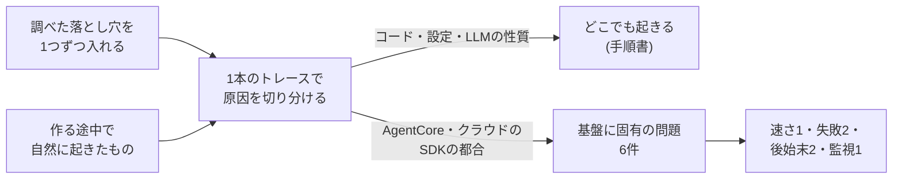
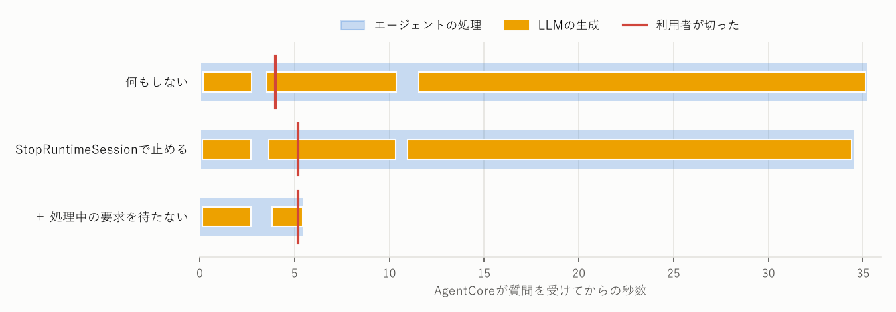
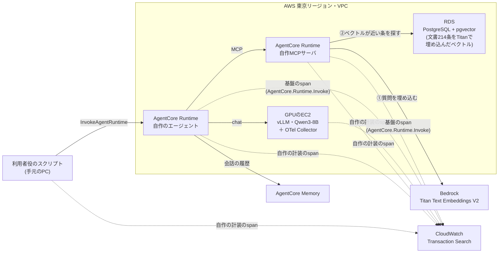

# agent-latency-tracer ― AIエージェントをAgentCoreに載せて見つけた、基盤に固有の問題6件。速さより、失敗・後始末・監視の見え方に出た

LLM(vLLM・Qwen3-8B)・自作のMCPサーバ・RAG(pgvector)を持つPython製のAIエージェントを、AWSのマネージドな基盤(Amazon Bedrock AgentCore Runtime)に載せたとき、
**遅れや失敗にどんな問題が加わるか**を調べた。呼び出し側から基盤・LLM・DBまでをOpenTelemetry(GenAI・MCPの規約)で1本のトレースにつなぎ、
作って動かす中で起きた遅れ・失敗の原因を切り分け、基盤に固有の問題を6件見つけた。どれも、調査から入れた落とし穴ではない。
調査から入れた落とし穴など、どこでも起きる事例と切り分け方は[手順書](docs/runbook.md)にまとめた。

> 運用改善の実績ではない(トラフィックは合成で、事例の一部はわざと入れた落とし穴)。オンプレは測っておらず、「どこでも起きる」かは一般的な情報と、手元だけの構成(llama.cpp・faiss)で起きたかで判断した。



---

## 結果サマリー

| 項目 | 値 |
|---|---|
| **基盤に固有の問題** | **6件(速さ1・失敗2・後始末2・監視の見え方1)** |
| 速さ | 基盤の部品(中継・Memory・セッションの起動)で費やす時間は1問35.2秒のうち約1秒。例外: MCPのセッションIDを送り返さないと、MCPサーバへの要求の半分が5〜8秒かかった |
| 失敗 | 同じ質問が2重に処理された(SDKの自動再送)。セッションの割り当て前に作ったDB接続が使えず、最初の検索が500を返した |
| 後始末 | 利用者が切っても、エージェントは答えを最後まで作った。DB接続はセッションの最後の使用から16〜21分残り、仮定した規模(300人・1日3問)の繁忙時には約380〜500本と見積もられ、上限400を超えうる |
| 監視の見え方 | AgentCoreのメトリクス`Latency`は、答えをSSEで流すと応答のヘッダまでしか測らない(0.07〜0.57秒。答えの終わりは6〜40秒) |
| 手順書 | どこでも起きる事例(調査から入れた落とし穴8件を含む14件)と、基盤の観察2件(セッションの起動の大きさ、15分空けた後の遅れ)を含む全22件。修正を確かめた11件、一部だけ確かめた2件、記録だけ7件、原因が未確認2件 |

**ツールを2回呼ぶ35.2秒の質問では、基盤の部品で費やす時間は約1秒(約3%)にとどまり、基盤に固有の問題は速さより、失敗の仕方・後始末・監視の見え方に出た。** 遅れの原因の多くは、基盤に載せても自分のコード・設定・LLMの側にあった。

| 用語 | 意味 |
|---|---|
| span / トレース | 処理1つの開始と終了の記録 / 1つの質問に属するspanの木 |
| 基盤側のspan | AgentCoreが出すspan(`AgentCore.Runtime.Invoke`)。自分のコードの外の時間が分かる |
| セッション | AgentCore Runtimeが会話ごとに割り当てる実行環境(microVM)。15分使われないと止まる |
| どこでも / この基盤だから | 起きる場所の分け方。前者はコード・設定・LLMの性質、後者はAgentCore・クラウドのSDKの都合による。直すかどうかとは別に分けた |

---

## 基盤の部品で費やす時間は1問で約1秒、ただしMCPのセッションの作法を外すと大きく遅れる

**呼び出し側で35.2秒かかった質問で、LLMの3回の呼び出しが32.9秒を占め、基盤の部品で費やした時間は合わせて約1秒だった。**


帯はエージェント側のspanから描いた(呼び出し側との差の約0.15秒は中継と答えの帰り)。ツールは2つずつ同時に呼ぶ。

| 基盤の部品 | 大きさ | いつ乗るか |
|---|---|---|
| 新しいセッションの起動 | 0.4〜0.6秒 | 会話の最初だけ |
| MCPサーバへの中継 | 0.08〜0.12秒(このトレースの4回) | ツール1回ごと |
| Memoryへの書き込み | 1回0.07〜0.2秒(この質問で8回、計0.6秒) | メッセージごと |
| 15分以上空けた後の、最初のツール呼び出し | +0.55〜0.85秒(原因は未確認) | 空けた後の1回だけ |
| **MCPのセッションIDを送り返さないとき** | **新しいmicroVMの起動で、試験スクリプトの要求8回中4回が5〜8秒(8回の計31秒が、送り返すと5.6秒)** | ツール1回ごと |

オンプレでも中継や履歴の保存にあたる部品は残るので、この約1秒がそのまま無くなるわけではない。最後の行は、AgentCoreがセッションIDでmicroVMを振り分けるのに、MCP(2026-07-28版)のクライアントがIDを送り返さないために起きた([awslabs/agentcore-samples#2264](https://github.com/awslabs/agentcore-samples/issues/2264)で報告)。根拠: [このトレースのwaterfall](traces/base/gpu4-q2.png)、[IDを送り返す前後のwaterfall](traces/mcp-session-id/)、手順書の[M2](docs/runbook.md#m2-mcpサーバへの呼び出しが毎回コールドスタートする)・[新しいセッションの約1秒](docs/runbook.md#観察-新しいセッションでも遅れは約1秒)。

---

## 失敗は、基盤の既定の振る舞いから起き、呼び出し側の記録だけでは見えなかった

**2件とも、呼び出し側からは「1回で75.7秒かかった質問」「たまに500になる質問」にしか見えず、基盤側のspanかサーバのログで原因が分かった。**

| 失敗 | 何が起きたか | 基盤の既定の振る舞い | 直し方と確かめ |
|---|---|---|---|
| 同じ質問の2重処理 | 1回の質問が基盤側で2回走り、1つ目は誰も受け取らないまま115秒GPUを使った | AWSのSDK(botocore)が60秒で読み取りを打ち切って再送し、AgentCoreは1つ目を止めない | 読み取り900秒・試行1回で、処理が1つになった |
| 割り当て前のDB接続 | 新しいセッションの最初の検索が500(接続の確認を足しても7.6〜8.5秒) | AgentCoreが割り当て前に起動しておくコンテナで作った接続は、割り当て後に使えない | プールを最初の`tools/list`で開き、0.16秒になった |

根拠: 手順書の[2重処理](docs/runbook.md#自然に発生-同じ質問が2重に処理されるクライアントの自動再送)・[割り当て前のDB接続](docs/runbook.md#自然に発生-割り当ての前に作ったdbの接続が切れている)。

---

## 利用者が切っても答えは作られ続け、DB接続は16〜21分残った

**AgentCoreの中継は呼び出し側の切断をエージェントに伝えず、MCPサーバのmicroVMは15分使われないとDB接続を閉じずに止まる。**



| 止め方(4〜5.2秒で切った質問) | エージェントの終わり | LLMの生成 |
|---|---|---|
| 何もしない | 35.8秒まで続けた | 最後まで |
| 切ったら`StopRuntimeSession`でセッションを止める | 34.4秒まで(合図の約30秒後) | 3回とも最後まで |
| ＋ サーバが処理中の要求を待たない(uvicornの`timeout_graceful_shutdown=0`) | 切った時刻ごろに`cancelled` | 約1秒で止まった |

```
接続の数 ≒ プールの本数(4) × 新しいセッションが来る速さ × (使われている時間 + 15分 + 1〜6分)
仮定: 300人・1日3問・繁忙時は平均の3倍・1問ごとに新しいセッション → 約380〜500本(RDSの max_connections は 400)
```

表の3行目の原因(uvicornが処理中の要求を待つ)はどこでも起きる。接続の数は、処理中の質問(同時6問なら24本)ではなく、生きているセッションの数で上限に届く。会話の終わりにMCPのセッションも止めると、接続はその場で閉じた。根拠: 手順書の[切断](docs/runbook.md#自然に発生-利用者が切ってもエージェントが答えを最後まで作る)・[DB接続](docs/runbook.md#観察-セッションが終わった後もdbの接続が16分残る)、[traces/disconnect/](traces/disconnect/)。

---

## 監視のメトリクスは、ストリーミングでは答えの長さを表さない

**答えをSSEで流すと、AgentCoreのメトリクス`Latency`は応答のヘッダを返すまでの時間になり、返し方を変えただけで監視のグラフが「速くなった」ように見える。**

| 返し方 | `Latency` | 答えが終わるまで |
|---|---|---|
| 答えを最後にまとめて返す(JSON) | 1.5〜115秒 | 合う |
| SSE | 0.07〜0.57秒 | 6〜40秒 |

公式の説明は「最後の応答トークンを送るまで」だが、SSEでは成り立たない。同じ名前空間の`Duration`も同じ値だった。答えの時間は呼び出し側で測る(見え始めまでと、呼び出し側のspanの長さ)。根拠: 手順書の[Latency](docs/runbook.md#観察-agentcoreのlatencyはストリーミングでは答えの長さを表さない)。

---

## 方法



| 部品 | 実装 |
|---|---|
| エージェント | Python・asyncioの自作のループ(既定値はStrandsに合わせた)。答えはSSEで返す |
| LLM | vLLM 0.31.0・Qwen3-8B bf16(NVIDIA L4)。開発中は手元のllama.cpp・Qwen3.5-2B |
| ツール | 自作のMCPサーバ(公式Python SDK 2.3.0、Streamable HTTP)。業務ツール4つ(合成データ)と文書検索(公的な規程・法令の214条) |
| 計装 | トレースの文脈はMCPの`params._meta.traceparent`とHTTPヘッダで渡す |

| 項目 | やり方 |
|---|---|
| 事例 | [調査メモ](docs/latency-pitfalls-survey.md)の落とし穴(出典つき)から、この構成で起きうるものを選び、環境変数`PITFALLS`で1か所だけ入れる。作る途中で自然に起きたものも同じ形で書く |
| 回し方 | GPUの回を4回。温めたセッションで、落とし穴あり/なしを同じ質問で1条件3〜6回。回数が少なく、同じ質問の繰り返しは独立した試行にならないので、平均やp95ではなく範囲と1問に占める割合で書く |
| 直すかどうか | 失敗は直す。遅れは、見え始め(答えの文字が見え始めるまでの時間)か答えの終わりを約20%以上延ばすなら直す(20%は人が所要時間の差に気づく目安とされる値で、業界で決まった基準ではない)。計装の正しさに関わるものは、大きさによらず直す |

---

## 限界と範囲外

| 項目 | 何が言えないか | 結論への影響 | 根拠 |
|---|---|---|---|
| 比べる相手 | オンプレサーバでは測っていない | 「約1秒」はオンプレとの差ではない | - |
| トラフィック | 合成。実際の利用者の分布での頻度は分からない | 各事例の重さは、1問の中の割合でしか言えない | - |
| 規模 | 同時6問・セッション数十まで | 接続が上限を超えるのは式からの見込みで、超えたときの壊れ方も見ていない | - |
| 応答品質 | 測っていない(検索のrecall@5だけ、合成ベクトル10万件で測った) | 速くなっても答えが悪くなっていないとは言えない | [設計書](docs/DESIGN.md) §8 |
| フレームワーク | エージェントは自作のループで、フレームワークは使っていない | フレームワークに固有の遅れ(内部の処理、独自の再試行)は見ていない | [設計書](docs/DESIGN.md) §1 |
| 版 | Qwen3-8B・vLLM 0.31.0・AgentCore Runtime V1(2026年11月時点)での見え方 | 中継やメトリクスの振る舞いは、サービス側の変更で変わりうる | - |
| 気づく側 | メトリクス・アラームは作っていない。各事例が既定のメトリクスに映るかだけ調べた | 切断や15分後の遅れなど、メトリクスに映らないものがある(vLLM 0.31.0は切られた要求を`abort`にも数えない) | [手順書の気づき方](docs/runbook.md#気づき方メトリクス) |

詳しい値: 全事例の症状・決め手・修正と症状から引く表は[手順書](docs/runbook.md)に、実測値と各GPUの回の記録は[設計書](docs/DESIGN.md)の§8にある。

---

## 実行環境と費用

| 項目 | 値 |
|---|---|
| GPUの回 | g6.xlarge(東京)で事例の回4回(2026-11-05・07・09・11)、計約4.5時間(ほかに準備の回2回)。Terraformで使うときに作り、終わったら消す |
| 費用 | 2026-10-31〜11-11で約$13(アカウント全体。11月分はCost Explorerの見込み値) |

## 動かし方

AWSを使わずに、MCPサーバとエージェントを手元で動かせる(検索はfaiss、トレースはJaegerで見る)。

```bash
# Linux(WindowsではWSL)で。venvは ~/.venvs/agent-latency-tracer に作り、pip install -e ".[dev]"
docker run -d --rm --name jaeger -p 16686:16686 -p 4318:4318 cr.jaegertracing.io/jaegertracing/jaeger:2.22.0
# ターミナル1: MCPサーバ(127.0.0.1:8000/mcp)。落とし穴を入れるなら PITFALLS=2 などを付ける
~/.venvs/agent-latency-tracer/bin/python -m system.mcp_server
# ターミナル2: 仮の質問をエージェントに流し、質問ごとにJaegerで開くURLを出す(llama.cppを127.0.0.1:8080で起動しておく)
~/.venvs/agent-latency-tracer/bin/python scripts/run_agent.py
```

`traces/`のJSONも、同じJaegerに送れば開ける(`curl -H 'Content-Type: application/json' --data-binary @traces/base/gpu4-q2.json http://localhost:4318/v1/traces`)。

AWSでは`infra/`のTerraformで作り、`-var pitfalls=1,2`のように落とし穴を選ぶ(作り方・消し方は[設計書](docs/DESIGN.md)の§6・§8)。

## ディレクトリ構成

| 場所 | 中身 |
|---|---|
| `system/` | 観測対象のエージェント、自作MCPサーバ、業務ツールと合成データ、落とし穴の切り替え |
| `tracing/` | 計装(spanの定義)、送り先の切り替え(手元はJaeger、AWSはCloudWatch)、公開用に伏せる処理 |
| `scripts/` | 手元とAWSでの実行、トレースの書き出し、READMEの図(`plot_*.py`) |
| `infra/` | Terraform(VPC・RDS・AgentCore・GPU) |
| `traces/` | 根拠のトレース(伏せたOTLP/JSONと、JaegerのwaterfallのPNG) |
| `docs/` | 手順書、設計書、調査メモ、ADR |

## 判断の記録

| ADR | 決めたこと | 状態 |
|---|---|---|
| [0001](docs/adr/0001-agentcore-runtime-placement.md) | MCPサーバとエージェントをAgentCore Runtimeに置き、GPUのサーバとは同居させない | 採用 |
| [0003](docs/adr/0003-gpu-8b-for-cases.md) | 事例の再現は、GPUで動かす8Bで行う | 採用 |
| [0004](docs/adr/0004-vllm-bf16-engine.md) | エンジンはvLLM 0.31.0とQwen3-8B bf16にする | 採用 |

ほかの決定は、却下した案とともに[設計書](docs/DESIGN.md)の§1にある。0002(業務ツールの作り方)は立てなかったので欠番で、根拠は[業務ツールの調査メモ](docs/tool-catalog-survey.md)にある。

## ライセンス・出典

- コードは[MITライセンス](LICENSE)。`data/corpus/`の文書には、下の別の条件がかかる
- 文書検索の文書は、厚生労働省のモデル就業規則・育児介護休業等に関する規則の規定例と、e-Gov法令検索の法令を条ごとに切り出して加工したもの。
  版・出典・加工した内容・利用条件は[data/corpus/README.md](data/corpus/README.md)にある
