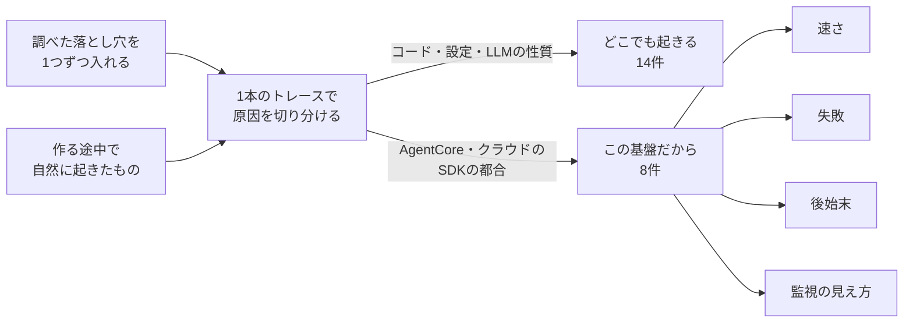
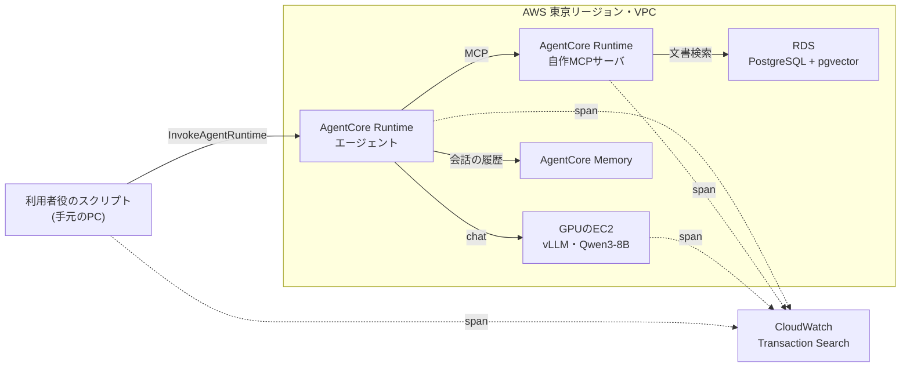

# agent-latency-tracer ― AIエージェントをAgentCoreに載せて変わったのは、速さではなく失敗と後始末だった

LLM(vLLM・Qwen3-8B)・自作のMCPサーバ・RAG(pgvector)を持つPython製のAIエージェントを、AWSのマネージドな基盤(Amazon Bedrock AgentCore Runtime)に載せ、
**自前のサーバで動かすのと比べて、遅れや障害の出方がどう変わるか**を調べた。呼び出し側から基盤・LLM・DBまでをOpenTelemetryで1本のトレースにつなぎ、
起きた遅れ・障害22件の原因を切り分けて、どこでも起きるものと、この基盤だから起きるものに分けた。切り分け方は[手順書](docs/runbook.md)にまとめた。

> 運用改善の実績ではない(トラフィックは合成)。事例の一部は、計装と手順書を確かめるためにわざと入れた障害である。
> 自前のサーバ(オンプレ)側は測っておらず、「どこでも起きる」かは一般的な情報と、手元だけで動かす形(llama.cpp・faiss・SQLite)で起きたかで判断した。AWSの振る舞いは2026年11月時点、AgentCore Runtime V1のもの。



---

## 結果サマリー

| 項目 | 値 |
|---|---|
| **22件の内訳** | **どこでも起きる14件、この基盤だから起きる8件** |
| 速さ | 基盤が足すのは1問で約1秒(呼び出し側で35.2秒のうち、LLMが32.9秒)。ただしMCPのセッションIDを送り返さないと、呼び出しの半分が5〜7秒かかった |
| 失敗 | 同じ質問が2重に処理された(SDKの自動再送)。セッションの割り当て前に作ったDB接続が使えず、最初の検索が500を返した |
| 後始末 | 利用者が切っても、エージェントは答えを最後まで作った(34.4秒)。DB接続はセッションの最後の使用から16〜21分残り、繁忙時の見積もりで上限400を超えうる |
| 監視の見え方 | AgentCoreのメトリクス`Latency`は、答えをSSEで流すと応答のヘッダまでしか測らない(83〜97ms) |
| 手順書の状態 | 修正を確かめた13件、記録だけ7件、原因が未確認2件 |

**速さは約1秒しか変わらず、変わったのは失敗の仕方・後始末・監視の見え方だった。** 遅れの原因の多くは、基盤に載せても自分のコード・設定・LLMの側にあった。

| 用語 | 意味 |
|---|---|
| span / トレース | 処理1つの開始と終了の記録 / 1つの質問に属するspanの木 |
| 基盤側のspan | AgentCoreが出すspan(`AgentCore.Runtime.Invoke`)。自分のコードの外の時間が分かる |
| セッション | AgentCore Runtimeが会話ごとに割り当てる実行環境(microVM)。15分使われないと止まる |
| どこでも / この基盤だから | 起きる場所の分け方。前者はコード・設定・LLMの性質、後者はAgentCore・クラウドのSDKの都合による |
| 見え始め | 答えの文字が見え始めるまでの時間。直すかどうかの判断に使う([方法](#方法)) |

---

## 速さは1問で約1秒しか変わらず、ただしMCPのセッションの作法を外すと大きく遅れる

**呼び出し側で35.2秒かかった質問で、LLMの3回の呼び出しが32.9秒を占め、基盤が足した時間は合わせて約1秒だった。**


帯はエージェント側のspanから描いた(呼び出し側との差の約0.15秒は、基盤の中継と答えの帰り)。ツールは2つずつ同時に呼んでいる。

| 基盤が足すもの | 大きさ | いつ乗るか |
|---|---|---|
| 新しいセッションの起動 | 0.4〜0.6秒 | 会話の最初だけ |
| MCPサーバへの中継 | 0.08〜0.12秒(エージェントの`MCP send`とサーバの`tools/call`の差) | ツール1回ごと |
| Memoryへの書き込み | 1回0.07〜0.2秒(この質問で8回、計0.6秒) | メッセージごと |
| 15分以上空けた後の、最初のツール呼び出し | +0.55〜0.85秒(原因は未確認) | 空けた後の1回だけ |
| **MCPのセッションIDを送り返さないとき** | **呼び出しごとに新しいmicroVMが起動し、8回中4回が5〜7秒(8回で31秒→送り返して5.6秒)** | ツール1回ごと |

最後の行は、AgentCoreがセッションIDでmicroVMを振り分けるのに、MCP(2026-07-28版)のクライアントがIDを送り返さないために起きた。
根拠: [このトレースのwaterfall](traces/base/gpu4-q2.html)、手順書の[M2](docs/runbook.md#m2-mcpサーバへの呼び出しが毎回コールドスタートする)・[新しいセッションの約1秒](docs/runbook.md#観察-新しいセッションでも遅れは約1秒)。

---

## 失敗は、基盤の既定の振る舞いから起き、呼び出し側の記録だけでは見えなかった

**2件とも、手元や起動直後のテストでは起きず、基盤側のspanかサーバのログを見て初めて原因が分かった。**

| 失敗 | 何が起きたか | 基盤の既定の振る舞い | 直し方と確かめ |
|---|---|---|---|
| 同じ質問の2重処理 | 1回投げた質問が、基盤側で2つの処理として走った。1つ目は誰も受け取らないまま115秒GPUを使った | AWSのSDK(botocore)は60秒で読み取りを打ち切って再送し、AgentCoreは1つ目を止めない | 読み取りタイムアウトを900秒、試行を1回に。基盤側の処理が1つになった |
| 割り当て前のDB接続 | 新しいセッションの最初の検索で500(接続の確認を足した後も7.6〜8.5秒) | AgentCoreはセッションを割り当てる前にコンテナを起動して待たせ、その間に作った接続は割り当て後に使えない | プールを最初の検索で開く。最初の検索が0.56〜1.33秒になった |

呼び出し側から見ると、前者は「1回で75.7秒かかった質問」、後者は「たまに500になる質問」にしか見えない。
根拠: 手順書の[2重処理](docs/runbook.md#自然に発生-同じ質問が2重に処理されるクライアントの自動再送)・[割り当て前のDB接続](docs/runbook.md#自然に発生-割り当ての前に作ったdbの接続が切れている)。

---

## 後始末が伝わらず、切った答えを作り続け、DB接続が16〜21分残った

**AgentCoreの中継は呼び出し側の切断をエージェントに伝えず、MCPサーバのmicroVMは15分使われないとDB接続を閉じずに止まる。**

| 止め方(4秒で切った質問) | エージェントの終わり | LLMの生成 |
|---|---|---|
| 何もしない | 35.8秒まで続けた | 最後まで |
| 切ったら`StopRuntimeSession`でセッションを止める | 34.4秒まで(合図の約30秒後) | 3回とも最後まで |
| ＋ サーバが処理中の要求を待たない(uvicornの`timeout_graceful_shutdown=0`) | 切った時刻ごろに`cancelled` | 約1秒で止まった |

```
接続の数 ≒ プールの本数(4) × 新しいセッションが来る速さ × (使われている時間 + 15分 + 1〜6分)
仮定: 300人・1日3問・繁忙時は平均の3倍・1問ごとに新しいセッション → 約380〜500本(RDSの max_connections は 400)
```

切断の2段目(uvicornが処理中の要求を待つ)は、どこでも起きる。どちらも既定のメトリクスには映らない(vLLM 0.31.0は切られた要求を`abort`にも数えない)。
接続は処理中の質問の数(同時6問なら24本)ではなく、生きているセッションの数で数えて初めて上限に届く。会話の終わりにMCPのセッションも止めると、その場で閉じた。
根拠: 手順書の[切断](docs/runbook.md#自然に発生-利用者が切ってもエージェントが答えを最後まで作る)・[DB接続](docs/runbook.md#観察-セッションが終わった後もdbの接続が16分残る)、[traces/disconnect/](traces/disconnect/)。

---

## 方法



| 部品 | 実装 |
|---|---|
| エージェント | Python・asyncioの自作のループ(既定値はStrandsに合わせた)。答えはSSEで返す |
| LLM | vLLM 0.31.0・Qwen3-8B bf16(NVIDIA L4)。開発中は手元のllama.cpp・Qwen3.5-2B |
| ツール | 自作のMCPサーバ(公式Python SDK 2.3.0、Streamable HTTP)。業務ツール4つ(合成データ)と文書検索(公的な規程・法令の214条) |
| 計装 | OpenTelemetry(GenAI・MCPの規約)。トレースの文脈はMCPの`params._meta.traceparent`とHTTPヘッダで渡す |

| 項目 | やり方 |
|---|---|
| 事例 | [調査メモ](docs/latency-pitfalls-survey.md)の落とし穴(出典つき)から、この構成で起きうるものを選び、環境変数`PITFALLS`で1か所だけ入れる。作る途中で自然に起きたものも同じ形で書く |
| 回し方 | GPUの回を4回(2026-11-05・07・09・11)。セッションを温めてから、落とし穴あり/なしを同じ質問で1条件3〜6回。temperature 0でも回が独立しないので、平均やp95ではなく範囲と1問に占める割合で書く |
| 起きる場所 | どこでも/この基盤だから。「誰の持ち物か」で分け、「直すか」とは別に書く |
| 直すかどうか | 失敗は直す。遅れは、見え始めか答えの終わりを約20%以上延ばすなら直す(20%は人が所要時間の差に気づく目安とされる値で、業界で決まった基準ではない)。計装の正しさに関わるものは、大きさによらず直す |

---

## 限界と範囲外

| 項目 | 何が言えないか | 結論への影響 | 根拠 |
|---|---|---|---|
| 比べる相手 | 自前のサーバでは測っていない | 「速さは約1秒しか変わらない」は、基盤が足した時間を基盤側のspanで測った値で、両方を並べて比べた値ではない | - |
| トラフィック | 合成。実際の利用者の分布での頻度は分からない | 各事例の重さは、1問の中の割合でしか言えない | - |
| 規模 | 同時6問・セッション数十まで | 接続が上限を超えるのは式からの見込みで、超えたときの壊れ方も見ていない | - |
| 応答品質 | 測っていない(検索のrecall@5だけ測った) | 速くなっても答えが悪くなっていないとは言えない | [設計書](docs/DESIGN.md) §8 |
| 版 | Qwen3-8B・vLLM 0.31.0・AgentCore Runtime V1での見え方 | 中継やメトリクスの振る舞いは、サービス側の変更で変わりうる | - |
| 気づく側 | メトリクス・アラームは作っていない。各事例が既定のメトリクスに映るかだけ調べた | 切断や15分後の遅れなど、メトリクスに映らないものがある | [手順書の気づき方](docs/runbook.md#気づき方メトリクス) |

詳しい値: 全事例の症状・決め手・修正と症状から引く表は[手順書](docs/runbook.md)に、実測値と各GPUの回の記録は[設計書](docs/DESIGN.md)の§8にある。

---

## 実行環境と費用

| 項目 | 値 |
|---|---|
| GPUの回 | g6.xlarge(東京)で事例の回4回、計約4.5時間(ほかに準備の回2回)。Terraformで使うときに作り、終わったら消す |
| 費用 | 2026-10-31〜11-11で約$13(アカウント全体、クレジットを除く。11月分はCost Explorerの見込み値) |

## 動かし方

AWSを使わずに、MCPサーバとエージェントを手元で動かせる(検索はfaiss、トレースは自作のSQLite保存と単一HTMLのwaterfall)。

```bash
# Linux(WindowsではWSL)で。venvは ~/.venvs/agent-latency-tracer に作り、pip install -e ".[dev]"
export TRACE_DB=~/traces/traces.db          # 測定中の書き込みが遅くならないよう、Linux側のディスクに置く
# ターミナル1: MCPサーバ(127.0.0.1:8000/mcp)。落とし穴を入れるなら PITFALLS=2 などを付ける
~/.venvs/agent-latency-tracer/bin/python -m system.mcp_server
# ターミナル2: 仮の質問をエージェントに流し、質問ごとのwaterfallをout/に出す(llama.cppを127.0.0.1:8080で起動しておく)
~/.venvs/agent-latency-tracer/bin/python scripts/run_agent.py
```

AWSでは`infra/`のTerraformで作り、`-var pitfalls=1,2`のように落とし穴を選ぶ(作り方・消し方は[設計書](docs/DESIGN.md)の§6・§8)。READMEの図は`pip install -e ".[plot]"`の後、`python scripts/plot_breakdown.py traces/base/gpu4-q2.json docs/img/one-question.png`で作り直せる。

## ディレクトリ構成

| 場所 | 中身 |
|---|---|
| `system/` | 観測対象のエージェント、自作MCPサーバ、業務ツールと合成データ、落とし穴の切り替え |
| `tracing/` | 計装(spanの定義)、手元用の保存とwaterfall、公開用に伏せる処理 |
| `scripts/` | 手元とAWSでの実行、トレースの書き出し、READMEの図(`plot_breakdown.py`) |
| `infra/` | Terraform(VPC・RDS・AgentCore・GPU) |
| `traces/` | 手順書の根拠のトレース(伏せたJSONとwaterfallのHTML、事例ごとのフォルダ) |
| `docs/` | 手順書、設計書、調査メモ、ADR |

## 判断の記録

| ADR | 決めたこと | 状態 |
|---|---|---|
| [0001](docs/adr/0001-agentcore-runtime-placement.md) | MCPサーバとエージェントをAgentCore Runtimeに置き、GPUのサーバとは同居させない | 採用 |
| [0003](docs/adr/0003-gpu-8b-for-cases.md) | 事例の再現は、GPUで動かす8Bで行う | 採用 |
| [0004](docs/adr/0004-vllm-bf16-engine.md) | エンジンはvLLM 0.31.0とQwen3-8B bf16にする | 採用 |

ほかの決定は、却下した案とともに[設計書](docs/DESIGN.md)の§1にある。

## ライセンス・出典

- コードは[MITライセンス](LICENSE)。`data/corpus/`の文書には、下の別の条件がかかる
- 文書検索の文書は、厚生労働省のモデル就業規則・育児介護休業等に関する規則の規定例と、e-Gov法令検索の法令を条ごとに切り出して加工したもの。
  版・出典・加工した内容・利用条件は[data/corpus/README.md](data/corpus/README.md)にある
