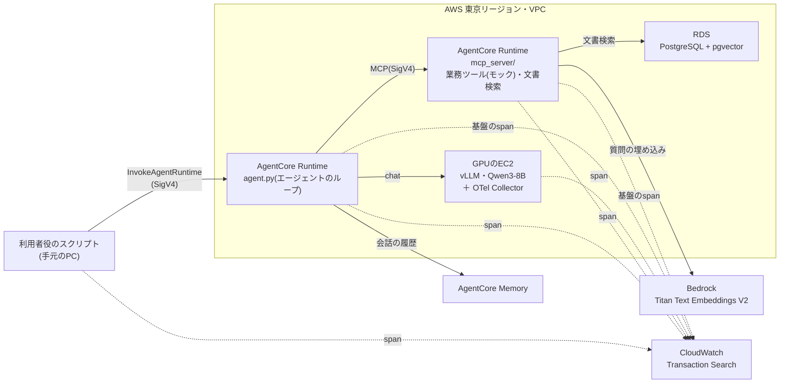

# 設計書: agent-latency-tracer

最終更新: 2026-11-14

「今どこまでできていて、次に何をやるか」を把握するための設計書。目的・構成・事例集は
[README.md](../README.md)、事例の出典は [latency-pitfalls-survey.md](latency-pitfalls-survey.md)。

## 1. 決定事項

| 項目 | 決定 | 理由 |
|---|---|---|
| MCPサーバの置き場所 | AgentCore Runtime | AWSのAIエージェント向けサービスの経験を得るため。比較の対象ではなく、土台として使う |
| エージェントの置き場所 | 段階5b以降はAgentCore Runtime(MCPサーバとは別のRuntime)。GPUのEC2とは同居させない。利用者役の手元のスクリプトが、`InvokeAgentRuntime`で呼ぶ | 一般的な形に合わせる。推論サーバ(GPU)とエージェント(CPUのアプリ)は、役割も増やし方も違うので分けて置き、同じVPCの中から呼ぶ。AgentCore RuntimeはAWSでエージェントを動かすための専用サービスで、既に土台として使っている。段階5まではエージェントを手元に置き、MCPサーバの移行と分けて確かめる |
| 認証 | IAMの署名(SigV4) | 手元のクレデンシャルで済み、Cognito(ユーザー管理)が要らない |
| RAG | RDS for PostgreSQL + pgvector、VPCの中だけ | 検索はMCPサーバのツールの1つで、使うかどうかはLLMが決める。AgentCoreのVPCモードでRDSにつなぎ、RDSはインターネットに出さない |
| MCPのSDKとプロトコルの版 | 公式Python SDK `mcp==2.3.0`(低レベルAPI)。プロトコルはSDKの初期設定のまま(2026-07-28版。相手が古い版なら自動で切り替わる) | 新しく作るなら何も指定しない状態が自然。古い版に固定する理由(「今は古い版が多い」)は推測にすぎなかった |
| LLM | 段階5までは手元のllama.cpp(公式Dockerイメージ`ghcr.io/ggml-org/llama.cpp:server`、b11434)で、Qwen3.5-2B(Q4_K_M、1.28GB)。段階5b以降は、GPUのEC2(g6.xlarge、NVIDIA L4)でvLLM 0.31.0とQwen3-8B bf16(2026-10-31決定)。どちらもthinkingはオフ | 段階5までは、つながることを確かめるだけでLLMの性能は効かないので、費用のかからない手元で進める。事例の再現(段階6)では、LLMが時間の大半を占めないGPUにする(「LLMの動かし方とモデルの大きさ」)。偽LLMは自動テストの中だけで使う |
| 段階5b以降のエンジン | vLLM 0.31.0、Qwen3-8B bf16。リクエストごとの内訳は応答の本文から取り(`--enable-per-request-metrics`・`--enable-prompt-tokens-details`)、エンジンのspan(`--otlp-traces-endpoint`)は補助にする | `toolcall-serving-bench`(L4 1台・Qwen3-8B)で精度の足切りを通ったのはvLLM bf16・FP8とTensorRT-LLM bf16・FP8の4構成で、目標の並行数が2以下では同じ台数で並び、ベンチは決めていない。このプロジェクトは質問を1つずつ流すので並行数は1〜2で、ベンチの結論からは決まらない。そこで、事例8/9・10・M1・12がエンジンの中で起きることから、中を見る手段で選んだ。vLLMはHTTPの`traceparent`を親にして`llm_request` spanを作り、待ち行列・プリフィル・デコードの時間を付ける。応答の本文にも待ち行列の時間とキャッシュに当たったトークン数が入り、llama.cppの`timings`と同じ作りで記録できる(v0.31.0のソースで確認)。版と起動の手順はベンチで固定済み。**採らなかった案**: TensorRT-LLM(1.2.1のトレースは試作段階の扱いで、親の引き継ぎを確かめていない。並行数4以上の台数の利点は、並行数1〜2では効かない)。FP8(並行数1〜2では台数の利点が無く、vLLMのFP8はL4ではW8A16で計算する、という注意書きが増える。文脈の長さがbf16で載らなければ見直す)。SGLang・AWQ(ベンチで精度の非劣化を示せなかった)。エンジンを比べ直すことはしない |
| 出口の無いVPCへのvLLMと重みの入れ方 | vLLMはコンテナにしてECRに置き、重みはS3に置いて、ゲートウェイ型エンドポイントから取り、起動のたびにインスタンス付属のNVMeへコピーして読む(§8)。どちらも`infra/`とは別に残す。最初の1回だけ、公開IPつきの仮のGPUサーバでイメージと重みを移し、起動フラグ・文脈の長さ・`traceparent`の引き継ぎを確かめる | コンテナでGPUを動かす経験を得るため(学ぶ目的)。公式イメージ`vllm/vllm-openai:v0.31.0`(圧縮時10.13GB)の保管は月約$1で、費用は決め手にならない。`transformers`はベンチの5.17.0に合わせ、イメージの版が違えばその1行だけ足す。**採らなかった案**: Python環境を固めてS3に置く(保管は月約$0.25で、ベンチの手順をそのまま使えるが、差は小さい)。NAT(作るたびに転送料金がかかり、VPCに外への出口ができる)。重みをAMIやコンテナに入れる(AMIはスナップショットから初めて読む部分が遅く、コンテナは重みを変えるたびに作り直しになる) |
| エンジンのspanの中継 | GPUのEC2でOpenTelemetry Collectorのcontrib版を、版を固定して動かす。vLLMからgRPCで受け、`sigv4auth`で署名してOTLP/HTTPで`xray`の受付口へ送る。spanを加工する部品は入れない | vLLMの送信部品はSigV4で署名できず、受付口はgRPCを受けない。AWSのCollectorの手順に沿え、AWS以外の環境でも同じ形で使える。**採らなかった案**: CloudWatch agent(今のAWSの文書が大抵の場合に勧めており設定も短いが、利点の多くはここで使わない連携にある)。ADOT Collector(役割も設定もほぼ同じで、contrib版で動かなければ切り替える)。以前ADOTを外した理由はPython側のSDKの話で、Collectorの選定には当てはまらない |
| 遅かった1件の見つけ方 | エージェントが質問ごとにtrace_idと所要時間を構造化ログに出す | 画面のトレースの一覧は索引(1%)に入ったものしか出ないので、「遅かった」と言われた1件はログからtrace_idを引いて開く(§5)。手順書の最初の段にする |
| トレースの集め先 | CloudWatch(Transaction Search) | AgentCoreの基盤側のspanと同じ場所に集める。実務で標準的なやり方 |
| Transaction Searchの設定 | `infra/account/`(状態ファイルは別のキー)で有効にし、段階ごとに消す`infra/`とは分けて残す。送り先はCloudWatch Logs、索引は初期値の1% | アカウントとリージョンに1つの設定。Terraformの説明では、送り先と索引のリソースを消してもAWS側の設定は戻らず、X-Rayに書き込みを許すログのリソースポリシーだけが消えて壊れる。spanを送らなければ費用はかからない。索引の割合は1%のまま上げない(§5で決めた) |
| 手元からCloudWatchへの送信 | ADOTを使わず、OTel標準のOTLP/HTTPの送信部品に、botocoreでSigV4の署名をする`requests`のセッションを渡す(ADOTの`OTLPAwsSpanExporter`と同じ作り)。手元の送り先(Jaeger)と並べて、CloudWatchを2つ目の送り先にできる(`TRACE_TO=otlp,cloudwatch`) | ADOTはOTelのSDKを1つの版に固定し、約50個の計装を一緒に入れ、TracerProviderを自分で組む前提で、このプロジェクトの`build_tracer_provider`と合わない。段階5のコンテナ(AgentCoreの公式の手順はADOTが前提)でも、ADOTは使わずに同じ送り方にした(§5) |
| 手元での開発 | AWS無しでも動く形を残す(検索はfaiss、トレースはJaeger) | 開発中の確認と、AWSを使わない読み手のため |
| トレースの表示 | Jaeger 2.22.0(コンテナ1つ、保存はメモリ)にOTLPで送る。CloudWatchの画面は使えるが、ログインが要るので公開には使わない | 汎用のトレース表示の定番で、OTLPをそのまま受ける。**採らなかった案**: 自作の保存とwaterfall(同じことをする既製品があり、公開用の形式も独自になる)。Grafana Tempo(表示にGrafanaが要り、手元の確認には重い)。Zipkin(OTLPを直接受けない)。Phoenix・Langfuse(LLMの呼び出しの中身を見る道具で、基盤側の時間を追う目的とずれる) |
| 事例の書き方 | 事例ごとに1ファイル。落とし穴ありと修正済みを並べる | 落とし穴のコードそのものが読めるようにする |
| 公開する根拠 | トレースを標準のOTLP/JSONで書き出し、Jaegerのwaterfallの画像と一緒に`traces/`に置く。アカウントID・ARNは伏せる | 読み手がAWS無しで結果を確かめられ、どのOTLPのバックエンドにも読み込める |
| 手元の実行環境 | WSLのUbuntu。エージェント・テスト・開発中のMCPサーバはWSLのvenv、llama.cppは公式のDockerイメージ。venvはWSLのホーム側に置く。リポジトリはWindows側のまま、WSLから`/mnt/c`越しに実行する | このPCではスマートアプリコントロールが署名の無いDLL(faiss)を止める。通信がWindowsとWSLをまたがないようそろえる。本番(AgentCore)もLinuxのコンテナ。`/mnt/c`越しのファイルの読み書きは遅いが、コードを読むのは起動時だけなので測定には混ざらない |
| インフラ | Terraform。使うときに作り、終わったら消す。状態ファイルは既存のS3バケットに別キーで保存 | 費用を抑える。状態ファイルにはアカウントIDやリソースのIDが入るためリポジトリに置かない |
| 手元からRDSへの接続(作業用) | Session Managerのポート転送。踏み台のEC2(t4g.nano、公開IPなし、受け入れの許可なし)と、SSMのインターフェース型エンドポイント3つ(ssm・ssmmessages・ec2messages)を、1つ目のサブネットに置く。RDSと一緒に作って消す | 表を作る・データを入れる・測るための裏口で、本ランの経路(AgentCore→RDS)には入らない。AWSがRDS向けの手順を公式に出している定番。EC2 Instance Connect Endpointは無料だが、公式の手順はEC2向けだけで、RDSへ直接つなぐ例は第三者のものしかなく、使えるポートの記述も食い違っていたので採らなかった。SSHで入る公開の踏み台は、インターネットゲートウェイが要るので採らない |
| RDSの設定 | PostgreSQL 18(小さい版の番号は固定しない)、db.t4g.medium(メモリ4GB)、パスワードはRDSに作らせSecrets Managerに置く(`manage_master_user_password`)、踏み台と同じAZ、バックアップなし | 18はRDSの初期設定。小さい版まで固定すると、その版が選べなくなったときに作れなくなるので、代わりに測るときの実際の版を§8に記録する。mediumは、表とHNSWのインデックスがメモリに収まる大きさ(一般的な選び方。収まらないとディスクの遅さが事例5に混ざる)。microでは表だけで`shared_buffers`に収まらなかった。パスワードが状態ファイルに入らない。AZをまたぐ1ms前後の遅れを検索の時間に混ぜない |
| pgvectorの測定の条件 | 1024次元×10万件(合成ベクトル、seedは0)。HNSWのパラメータはpgvectorの初期値(`m=16`・`ef_construction=64`・`ef_search=40`)。質問100個、top-5。時間は`EXPLAIN (ANALYZE, TIMING OFF)`のDBの中の実行時間で、1周温めてから測る | 条件は結果を見る前に、現実の値から決めた(差が出るように逆算しない)。1024はTitan Text Embeddings V2の初期値・bge-m3・multilingual-e5-largeの次元。10万件は中規模の社内文書(5,000件×20チャンク程度)。top-5はMCPサーバの初期値。手元のfaiss(128次元×50万件)は遅さを見せるための逆算で、手元の確認用に残す |
| AgentCore Runtimeのネットワーク | VPCモード。サブネットは1つ目(`apne1-az1`)だけ。インターフェース型エンドポイント6つ(`ecr.api`・`ecr.dkr`・`logs`・`xray`、のちに`bedrock-agentcore`・`bedrock-runtime`)を同じサブネットに置き、受け入れはRuntimeのセキュリティグループからだけ。実行ロールは公式の例から、ECRをこのリポジトリに絞り、`logs:PutResourcePolicy`を外した。Bedrockのモデルの権限は、MCPサーバのロールにTitan Text Embeddings V2の`InvokeModel`だけを持たせた | ecr・logsは、外への出口が無いVPCでは公式に必須。xrayはトレースをCloudWatchに送る受付口。AWSの推奨はAZの違う2つ以上のサブネットだが、可用性は目的の外で、RDSと別のAZに置かれるとAZをまたぐ遅れが検索に混ざるので1つにした(エンドポイントの費用もAZの数だけ倍になる)。Runtime本体は、中に入れる本物のイメージ(MCPサーバ)と一緒に段階5で作った。`bedrock-agentcore`はエージェントからMCPサーバのRuntime・Memoryを呼ぶため、`bedrock-runtime`は質問の埋め込みのため |
| エージェントの作り方 | フレームワーク(Strands・LangGraph・OpenAI Agents SDKなど)を使わず、asyncioでループを書く。既定値は主なフレームワークに合わせる(下の「エージェントの基本形」) | 落とし穴の多く(#1 1つずつ待つ、#2 ブロッキング呼び出し、#3 ループの繰り返し、#10 先頭の時刻)はループの書き方そのもので、1か所だけ入れて比べるには自分のコードである必要がある。spanをすべて自分で定義でき、フレームワーク独自のspanと混ざらない。引き換えに、フレームワークに固有の遅れ(内部の処理、独自の再試行)は範囲の外 |
| エージェントの基本形 | 1回の応答で頼まれたツール呼び出しは`asyncio.gather`で同時に実行し、MCPの接続とツールの一覧は使い回す。システムプロンプトは付けない(#10の落とし穴を入れたときだけ、先頭に時刻を書く)。LLMを呼ぶのは1回の質問につき最大10回。会話はセッションの間メモリに持ち、直近40メッセージを残す(2026-11-06から)。AWSでは、メッセージを足すたびにAgentCore Memory(短期の記憶)にも書き、プロセスにその会話が無いとき(新しいセッション、15分の後の新しいmicroVM)だけ読み戻す(2026-11-09から) | 事例の「直した書き方」の基準。10はOpenAI Agents SDKの`DEFAULT_MAX_TURNS`(LangChainは15、smolagentsは20)。日付をシステムプロンプトに入れる話は#10の事例で扱う。会話の持ち方はAgentCoreの公式のセッションの説明(セッションの間は状態を保ち、それを超えて残すならAgentCore Memory)に合わせ、40はStrands Agentsの既定(`SlidingWindowConversationManager(window_size=40)`)。GPUの1回目までは質問ごとに会話を捨てていた(事例はどれも同じ回の基準と比べるので、1回目の結果はそのまま読める)。Memoryの読み書きの形は、AWSの文書が紹介するStrands Agentsの連携(`AgentCoreMemorySessionManager`)に合わせた: エージェントを作るときに1回読み(`ListEvents`、strands-agents/sdk-python#1272)、メッセージごとに書く(`batch_size`の既定1)。保存は1メッセージ1イベントで、セッションはRuntimeのセッションID、利用者(`actorId`)はログインが無いので固定。長期の記憶(会話から事実を抜き出す)は抜き出しの精度の話になるので入れない。Memoryの書き込みは、11-09より前の回の基準には無い |
| LLMへのリクエスト | ストリーミングで受け、temperatureは0にする。`max_tokens`は付けない | ストリーミング: TTFTはllama.cpp以外のサーバでも測れ、チャットの体感の速さを決め、llama.cppの読み込み時間との差で通信などの分が分かる。temperature: llama.cppの初期値0.8では、同じ質問でツール呼び出しの数が2つになったり4つになったりした。`max_tokens`: 主なフレームワークは初期値で付けない。止まらない生成(§7の9)は#9の材料なので、基準の側で隠さない |
| LLMの動かし方とモデルの大きさ | 事例の再現はGPUの8Bで行う。モデルの大きさは比べない | 手元のCPUで2Bを動かすと、1問18〜63秒のほとんどをLLMが占め、ツールの実行は1回1秒未満だった(§8)。事例の差(数十ミリ秒〜数秒)がLLMの時間に埋もれ、どの遅れが体感に効くかの比率が実際のサービス(GPUで推論)と大きく違う。答えの正しさは目的の外のまま。2026-10-11に「2Bのまま」と決めたが、この点を見落としていたため改めた |
| 答えの返し方 | SSEで返し、15秒ごとに`: ping`を送る。呼び出し側の切断に気づいたら処理を止め、spanに`cancelled`を付ける(PR #37) | 見え始め(答えの文字が見え始めるまで)を測るため。チャットの一般的な形 |
| 切断の後始末 | 呼び出し側が切ったら`StopRuntimeSession`でセッションを止める(PR #41)。エージェントのサーバは、止める合図(SIGTERM)で処理中の要求を待たない(uvicornの`timeout_graceful_shutdown=0`、PR #45) | AgentCoreの中継は切断をエージェントに伝えない([手順書](runbook.md)「利用者が切っても、エージェントが答えを最後まで作る」) |
| AWSのクライアントの再試行 | botocoreのクライアントはすべて`standard`の再試行にする(PR #44)。質問を送るクライアントだけ、読み取り900秒・試行1回 | `StopRuntimeSession`の409(用意中・片づけ中)を文書どおり再試行するため。質問は2重に処理されないよう1回だけ送る(手順書「同じ質問が2重に処理される」) |
| DBの接続プール | `open=False`で作り、最初の`tools/list`で開く(先に検索が来たら検索で開く。PR #25・#36)。渡す前に`check`で確かめる | 割り当て前に作った接続は使えない(手順書「割り当ての前に作ったDBの接続が、切れている」)。`tools/list`で開けば、最初のLLMの呼び出しの間に接続ができる |
| テスト | PRとmainへのpushでpytestを回す(PR #48)。pgvectorはCIの中で立てたPostgreSQL | 外のサービスに頼らない。伏せたトレースに残してはいけない値が無いかも確かめる |

## 2. 全体の流れ

- 段階5までは、エージェントとllama.cpp(2B)を手元に置き、MCPサーバだけをAgentCoreに置いた
- 事例ごとに1か所だけ落とし穴ありに切り替える → CloudWatchで見え方を確かめる → docs/runbook.mdに書き、トレースをtraces/に書き出す
- 見分けられない → 計装を足す → 足す前と後を比べる

## 3. コンポーネントと状態

| 場所 | 役割 | 状態 |
|---|---|---|
| [tracing/instrumentation.py](../tracing/instrumentation.py) | OTel GenAI規約・MCP規約のspan builder、グローバルProviderの登録。保存は`batch=True`で`BatchSpanProcessor`(テストは`SimpleSpanProcessor`)。送り先は複数渡せ、それぞれに別のprocessorを付ける | ✅ |
| [tracing/exporter.py](../tracing/exporter.py) | spanの送り先(`TRACE_TO`。手元はJaegerへOTLP、AWSはCloudWatch) | ✅ |
| [tracing/aws_exporter.py](../tracing/aws_exporter.py) | spanをCloudWatch(Transaction Search)に送る。OTLP/HTTPとSigV4(依存は`aws`の組) | ✅ |
| [tracing/published.py](../tracing/published.py) | `traces/`に置くトレースを伏せる。残す属性のキーを決め、残した値の中のアカウントID・ARNも置き換える | ✅ |
| [system/tools/](../system/tools/) | 業務ツール4つの定義(`catalog.json`)、データの種類と項目(`data_schema.json`)、合成データ(`mock_data.json`)、モック実行(200〜800ms待ってから、合成データを条件で絞り・集計して返す) | ✅ |
| [system/retrieval/](../system/retrieval/) | 手元用の検索(faiss)、合成ベクトルの生成 | ✅(合成ベクトルはpgvectorへの投入にも使う) |
| [system/tools/per_type.py](../system/tools/per_type.py) | 落とし穴M1のツール一覧(データの種類ごとに検索・1件取得・集計の45個。中では基準のツールに置き換えて実行する) | ✅ |
| [system/pitfalls.py](../system/pitfalls.py) | 環境変数`PITFALLS`で入れる落とし穴を読み、resource属性`scenario.pitfalls`に記録する | ✅ |
| [system/mcp_server/](../system/mcp_server/) | 自作MCPサーバ(低レベルAPI、Streamable HTTP、`/mcp`、ステートレス)。業務ツール＋文書検索`retrieve_documents`(faissかpgvector。pgvectorでは質問をTitan Text Embeddings V2で埋め込み、本文つきで上位10件(上限20)を返す。RDSにはIAMのトークンでログインし、接続プールは最初の`tools/list`で開く)。AgentCore用のコンテナは`Dockerfile`。計装オンのときはHTTPリクエストごとのspan(`opentelemetry-instrumentation-asgi`)も出す。`MCP_SERVER_OTEL=0`で計装オフ | ✅ |
| [system/mcp_client.py](../system/mcp_client.py) | SDKの`Client`を包み、tool呼び出しを`execute_tool` spanで囲む。HTTPヘッダにも`traceparent`を載せる(`httpx2`の`event_hooks`)。AgentCoreのURLならSigV4で署名し、`Mcp-Session-Id`を送り返す(§7の12)。`async with`の間は接続を使い回す | ✅ |
| [scripts/try_mcp.py](../scripts/try_mcp.py) | 手元の動作確認。ツール3つを「1つずつ」と「同時に」で呼び、JaegerのURLを出す | ✅ |
| [scripts/run_agent.py](../scripts/run_agent.py) | 手元の動作確認。仮の質問(§6の3)をエージェントに流し、質問ごとにJaegerのURLを出す | ✅ |
| [scripts/gpu_prepare.sh](../scripts/gpu_prepare.sh)・[infra/gpu_prepare/](../infra/gpu_prepare/) | 仮のGPUサーバと、その中で動かす手順。イメージと重みを移し、本番と同じ経路で1回試す。ふだんは作らない。NVMeを使う形に直した後は動かしていない | ✅ |
| [infra/gpu.tf](../infra/gpu.tf)・[infra/gpu_boot.sh.tftpl](../infra/gpu_boot.sh.tftpl) | VPCの中のGPUサーバ(vLLM＋Collector)と、起動手順。`terraform apply -target=aws_instance.gpu`で、要るエンドポイントごと作る | ✅ |
| [system/serving/otel-collector.yaml](../system/serving/otel-collector.yaml) | Collectorの設定(§1) | ✅ |
| [system/llm/](../system/llm/) | OpenAI互換クライアント。ストリーミングで受け、chat spanにTTFTとエンジンの内訳(llama.cppの`timings`、vLLMの`metrics`)、送ったツール定義の数を記録する。断片で届くツール呼び出しを組み立てる。HTTPヘッダに`traceparent`を載せる | ✅ |
| [system/agent.py](../system/agent.py) | エージェントループ(§1の「エージェントの基本形」) | ✅ |
| [system/agent_server.py](../system/agent_server.py)・[Dockerfile.agent](../Dockerfile.agent) | エージェントのHTTPの入口(AgentCore Runtimeの決まりに合わせ、ポート8080の`GET /ping`と`POST /invocations`)。受け取った`traceparent`のトレースに入り、セッションIDを`gen_ai.conversation.id`に記録する。接続先は環境変数で渡す(`MEMORY_ID`があればAgentCore Memoryを使う)。Runtimeは`infra/agentcore_agent.tf` | ✅ |
| [system/memory.py](../system/memory.py) | AgentCore Memoryへの会話の読み書き(§1の「エージェントの基本形」)。呼び出しごとに`BedrockAgentCore.ListEvents`・`BedrockAgentCore.CreateEvent`のspan(AWS SDKの規約の名前)を作り、送り直しの回数を付ける | ✅ |
| [scripts/invoke_agent.py](../scripts/invoke_agent.py) | 利用者役。Runtime上のエージェントに仮の質問を`InvokeAgentRuntime`で投げ、自分のspanの`traceparent`を付ける。既定は回の初めにセッションを温めて使い回す(`--cold`で質問ごとに新しいセッション)、`--concurrent`で同時に投げる、`--cut-after`で切って`StopRuntimeSession`で止める | ✅ |
| [infra/](../infra/) | Terraform(VPC・RDS・踏み台・AgentCore Runtime・基盤側のspanの配送)。AgentCore Memory、VPCエンドポイント。`infra/account/`はTransaction Search。`infra/artifacts/`はイメージ(ECR。vLLM・Collector・MCPサーバ・エージェント)と重み(S3)の置き場で、段階ごとに消さない | ✅ |
| [scripts/build_corpus.py](../scripts/build_corpus.py)・[embed_corpus.py](../scripts/embed_corpus.py)・[load_pgvector.py](../scripts/load_pgvector.py)・[measure_pgvector.py](../scripts/measure_pgvector.py) | 文書を条ごとに切る(`data/corpus/`)→ Titanで埋め込む → RDSに入れる。事例5の測定(HNSWなし/あり) | ✅ |
| [scripts/export_trace.py](../scripts/export_trace.py) | トレースをCloudWatchから読み、伏せたOTLP/JSONを`traces/`に書き出す | ✅ |
| [scripts/collect_gpu.sh](../scripts/collect_gpu.sh) | destroyの前に、GPUサーバのログ・vLLMの`/metrics`・5秒ごとの記録を手元に回収する | ✅ |
| [scripts/plot_breakdown.py](../scripts/plot_breakdown.py)・[plot_cut.py](../scripts/plot_cut.py) | READMEの図(1問の内訳、切断の止め方) | ✅ |
| [tests/](../tests/)・[.github/workflows/test.yml](../.github/workflows/test.yml) | テスト(偽のLLM・偽のAWS・プロセス内のMCP。pgvectorはCIの中で立てたPostgreSQL)。PRとmainへのpushで回す | ✅ |
| [docs/runbook.md](runbook.md)・[traces/](../traces/)・[docs/adr/](adr/) | 手順書、根拠のトレース、判断の記録 | ✅ |

## 4. span設計

### 今あるもの

| span | 作るもの | 主な属性 |
|---|---|---|
| `InvokeAgentRuntime`(CLIENT、root) | 自作(`scripts/invoke_agent.py`、サービス名`caller`) | `caller.time_to_first_text_ms`(呼び出し側で見た最初の文字)、`caller.warmup`、`caller.cut_after_s`(切った秒数) |
| `StopRuntimeSession`(CLIENT) | 自作(同上) | 切った後にセッションを止める呼び出し |
| `invoke_agent <名前>` | 自作(`agent.py`) | `gen_ai.agent.name`、`gen_ai.conversation.id`(RuntimeのセッションID)、`agent.time_to_first_text_ms`。上限で打ち切ると`error.type=max_turns_exceeded`、切られると`cancelled` |
| `execute_tool <ツール名>` | 自作(`mcp_client.py`) | `gen_ai.tool.name`, `gen_ai.tool.call.id`, `mcp.method.name`, `mcp.protocol.version` |
| `chat <モデル名>` | 自作(`llm/client.py`) | `gen_ai.usage.input_tokens` / `output_tokens`、`gen_ai.request.temperature`、`gen_ai.response.finish_reasons`、`llm.time_to_first_token_ms`(クライアント側のTTFT)、`llamacpp.prompt_n` / `cache_n` / `prompt_ms` / `predicted_n` / `predicted_ms`(llama.cppの内訳)、`vllm.queue_time_ms` / `time_to_first_token_ms` / `generation_time_ms` / `mean_itl_ms` / `tokens_per_second` / `cached_tokens`(vLLMの内訳)、`llm.request.tool_count`(送ったツール定義の数) |
| `llm_request`(SERVER) | vLLM(OTel Collector経由) | エンジンの中の待ち行列・プリフィル・デコード。親は`chat`が送った`traceparent` |
| `BedrockAgentCore.ListEvents` / `CreateEvent`(CLIENT) | 自作(`memory.py`、AWS SDKの規約の名前) | `agent.memory.events`(読み戻した件数)、`botocore.retry_attempts` |
| `MCP send <メソッド>`(CLIENT) | SDK(手元側) | `mcp.method.name`, `jsonrpc.request.id`。この中で`params._meta`に`traceparent`を書き込む |
| `POST /mcp`(SERVER) | `opentelemetry-instrumentation-asgi`(サーバ側) | HTTPリクエストを受け取ってから応答を返し終わるまで。親はHTTPヘッダの`traceparent` |
| `<メソッド>`(SERVER、例: `tools/call find_records`) | SDK(サーバ側のmiddleware) | `mcp.method.name`, `mcp.protocol.version`, `gen_ai.tool.name`, `error.type` |
| `embeddings amazon.titan-embed-text-v2:0`(CLIENT) | 自作(`mcp_server/server.py`) | `gen_ai.usage.input_tokens`、`gen_ai.embeddings.dimension.count`、`botocore.retry_attempts` |
| `SELECT documents`(CLIENT) | 自作(同上) | `db.system.name`、`db.query.text`(値を含まない)、`db.response.returned_rows`、`retrieval.document_ids` / `scores` / `text_chars`(本文は残さない) |
| `AgentCore.Runtime.Invoke`(SERVER) | AgentCoreの基盤 | `aws.operation.name`、`latency_ms`、`session.id`。エージェントとMCPサーバのRuntimeそれぞれに出る |

- 属性の名前: `gen_ai.*`・`mcp.*`・`db.*`・`error.type`はOTelの規約(GenAI・MCP・DB)の名前。規約に無い値は、作る側の名前を接頭辞にした独自の属性にした
  (`caller.*`・`agent.*`・`llm.*`・`llamacpp.*`・`vllm.*`・`retrieval.*`・`botocore.retry_attempts`)。例えばTTFTは、規約ではメトリクス(`gen_ai.server.time_to_first_token`)にしか無い。
  `llamacpp.*`・`vllm.*`は推論サーバが返す内訳をそのまま写したもので、サーバを替えると無くなる
- SDKのspanはグローバルのTracerProviderに送られる。登録しないと捨てられ、`traceparent`も送られない
  (`set_global_tracer_provider`)
- HTTP越しでは`execute_tool` → `MCP send tools/call` → サーバの`tools/call`の3段が1本のトレースになる。
  HTTPを使わない接続(テストで使う)では`MCP send`が作られず、サーバのspanが`execute_tool`の直下につく
- 2026-07-28版のMCPにはあいさつ(`initialize`)もセッションIDも無い。最初の`server/discover`は版の問い合わせだけ
- resource属性: `service.name`、`scenario.pitfalls`(入れた落とし穴)、`process.creation.time`(プロセスの起動時刻。新しいmicroVMかどうか)を全spanに付ける
- `retrieval` spanの組み立て(`retrieval_span`)は`tracing/instrumentation.py`にあるが、今の検索は`embeddings`と`SELECT`の2本で記録し、`retrieval`は作っていない

### 基盤のメトリクスと、記録していないもの

- AgentCoreの基盤のメトリクス(`Latency`、`Invocations`、`Sessions`等)は、spanとは別にCloudWatchのメトリクスで読む。
  何が映り何が映らないかは手順書の「気づき方(メトリクス)」
- AgentCoreが付ける`Mcp-Session-Id`は、自作のspanには記録していない(`mcp.session.id`の定数だけある)。セッションは基盤のspanの`session.id`で読む

### 見分けにくいと予想していた組み合わせ(結果は手順書)

| 組み合わせ | 予想される見え方 | 見分けるのに要りそうなもの |
|---|---|---|
| #1 逐次await / #2 ブロッキング呼び出し | どちらもtool spanが階段状 | 並列化を意図したかの記録、イベントループの遅延 |
| R リトライ | 1つのtool spanの中に隠れる | 試行ごとのspan event。2026-11-10: エージェント→MCPはMCPのSDKが要求ごとにspanを出し、タイムアウトはその中のエラーになるので、SDKのspanを受け取っていれば見える。再現は外した(手順書の事例の一覧)。既定で再送するAWSのSDKの区間は、相手側(AgentCore)のspanで見つけた(手順書「同じ質問が2重に処理される」) |
| M2 クライアントの作り直し | tool呼び出しが一律に遅い | `server/discover`/`tools/list`のspan、AgentCoreの`Mcp-Session-Id`と新しいmicroVMかどうか |
| #8 長い入力 / #9 長い出力 | どちらもchat spanが長い | TTFT |
| ネットワーク / AWSの基盤 / サーバのコード | エージェント側のspanだけでは区別できない | AgentCoreの`InvokeAgentRuntime` span、サーバ側span、新しいセッションかどうか |

## 5. 確認が必要なこと(作る段階で確かめる)

- AgentCoreの基盤側のspanが、自分のspanと1本のトレースにつながるか(2026-10-28に解決): つながる。span名は
  `AgentCore.Runtime.Invoke`(`aws.operation.name`が`InvokeAgentRuntime`、`latency_ms`・`session.id`付き)。
  クライアントが送った`traceparent`を親にし、コンテナの`POST /mcp`はその子になる。Runtimeのトレースを有効にするのは、
  CloudWatch Logsの配送(送り元`TRACES`、送り先`XRAY`)でTerraformから書けた(公式のSDKの例はmemoryとgatewayだけを挙げていた)。
  ヘッダの許可リストには`traceparent`・`tracestate`を入れた(入れない場合に届くかは確かめなかった)
- VPCモードのとき、コンテナからCloudWatchにトレースを送る経路(2026-10-28に解決): `xray`のインターフェース型
  エンドポイント経由で届いた(NATなし)。実行ロールに`xray:PutSpans`が要る
- AgentCore Runtimeの課金(待機中にも費用がかかるか)(2026-11-14に公式の料金ページで確認): セッションの間だけかかる。V1はvCPU 1時間$0.0895・
  メモリ1GB 1時間$0.00945を1秒単位で、microVMの用意からセッションの終了まで(使われない時間を含む)数える。I/O待ちの間はCPUがゼロになる
  (この記述は版を分けていない)。セッションが無いときの課金は書かれていない。実額では、Runtimeを消した11-12・11-13のAgentCoreは$0
- 手元からCloudWatchにOTLPで送るときの受付口の仕様と署名の方法(2026-10-26に解決): 受付口は
  `https://xray.<リージョン>.amazonaws.com/v1/traces`で、OTLP/HTTP(protobuf)だけを受け、gRPCは受けない。署名はSigV4で、
  サービス名は`xray`。Transaction Searchが有効でないと受け付けない
- **AgentCore Observability**(2026-10-28に解決): `UNIFIED_TRACES_DESTINATION_ENABLED=false`で基盤側のspanもaws/spansに寄せ、
  `logs:PutResourcePolicy`は戻していない。ADOTは使わず、`DISABLE_ADOT_OBSERVABILITY=true`でRuntimeが入れる`OTEL_*`の
  環境変数を消した(標準のOTLPエクスポーターがヘッダなどを環境変数からも読むため)
- **AWSの画面でトレースを見る方法**(2026-10-31に解決): 索引の割合は1%のまま、トレースIDをX-Ray形式にして、画面の
  waterfallで見る。事例の記録に載せるトレースは、`StartTraceRetrieval`で取り出してOTLP/JSONで`traces/`に置く
  - トレースの一覧と`batch-get-traces`は、索引(トレースの要約)に入ったトレースだけを返す。索引はトレースIDごとに確率で選ばれる
    (初期値1%)ので、手元から流す少ないトレースはまず入らない(2026-10-27に0件)。基盤のヘルスチェックと思われる2spanの
    トレースが約2秒おきに入っていたが、確率で選ぶので、自分のトレースの枠を奪うわけではない
  - 索引に入っていないトレースも、トレースIDを指定すれば画面のトレースの詳細(waterfall)で開ける(スマホでも見えた)。
    ただしIDの先頭8桁を作成時刻(Unix時刻の16進数)として読むので、OpenTelemetryの既定のランダムなIDでは
    「有効期限が切れています」になる(先頭が2014年を指したID)。先頭を今の時刻にしたIDで送ると開けた
  - APIの`StartTraceRetrieval`→`ListRetrievedTraces`(`--trace-format OTEL`)では、時刻の範囲を指定すれば
    既定のIDのトレースも取り出せた(32spanすべて)
  - 閲覧用のIAMユーザーには、AWS管理ポリシー`CloudWatchReadOnlyAccess`が要る。画面は索引外のトレースを
    `xray:StartTraceRetrieval`で取り出しており、これが無いと開けない
  - 割合を上げる案は採らない。1%を超える分は索引に入れたspanの数で課金され、索引は条件(サービス名など)では絞れず
    割合しか指定できない。費用自体は小さい見込み(公式価格での概算で、Runtimeを1か月置いて100%にしても約2ドル。東京の単価は索引に入れたspan 100万本あたり$0.75で、2026-11-14に価格表APIで確認)
- RDSで使えるpgvectorのバージョン(2026-10-25に解決): 東京のRDS for PostgreSQL 18系では0.8.1(18.1〜18.3)・
  0.8.2(18.4以降)。初期設定の18.3では0.8.1だった(§8)
- この PC の CPU で llama.cpp の小さいモデルがどれくらいの速さで動くか(ツール定義入りのプロンプトで)(2026-10-07に解決): §8の「llama.cpp(Qwen3.5-2B)」
- **AgentCoreのセッションID**(2026-10-28に解決): 2026-07-28版のMCPにはセッションが無いので、SDKのクライアントは送り返さない。AgentCoreの振り分けに要るので、自作のクライアントで送り返す(§7の12)
- **AgentCoreに載せるときのサーバ設定**(2026-10-28に解決): `stateless_http=True`、ホストは`0.0.0.0`、ARM64のコンテナ
- **ツールの結果に中身を持たせるか**(2026-10-08に解決): `{"status": "ok"}`だけを返すモックでは、LLMが作り話をしたり
  同じ呼び出しを繰り返したりした。0件と明示する・条件を無視した仮の行を返す・小さな合成データを条件で絞る、の3通りを
  試し、2段以上の質問が止まるのは最後だけだった。そこで、15種類それぞれ数件の合成データを持たせ、`filter`で絞って返す
  形にした(DBの遅さを見るためではなく、会話を自然に進めるため。待ち時間は今までどおりモックの200〜800ms)

## 6. 次にやること

- [x] 1. AWS CLIとTerraformの確認(2026-10-03: WSLのUbuntuに導入済み。AWS CLI 2.36、Terraform 1.15、東京リージョンのIAMユーザーで認証できる)
- [x] 2. 自作MCPサーバ(低レベルAPI)と計装つきMCPクライアントを、手元で動かす(2026-10-04。§7の「動かしていて見つかったこと」)
- [x] 2a. §7の2(正体の分からない待ち時間)を調べる(2026-10-04。原因は自作のSQLite保存。§7の2)
- [x] 2b. 業務ツールのカタログを作り直す(2026-10-06)。それまでの40個は`toolcall-serving-bench`のカタログ(選択を難しくするため、
  似た機能のツールをわざと並べたもの)の流用で、このプロジェクトとしての根拠が無い。方針は、Anthropicの
  [ツール設計の指針](https://www.anthropic.com/engineering/writing-tools-for-agents)(APIをそのまま包まず用途ごとにまとめる、
  機能の重なりを避ける)に沿った形を基本にし、公開されている業務システムのMCPサーバ(freee・Salesforce・
  Dynamics 365など。少数の汎用ツール型が多い)も調べてから決める。「APIをそのまま包んだ汎用ツール(往復が増える)」
  「似たツールを大量に並べる(M1、選び間違い)」は事例の落とし穴として再現する候補
  - 2026-10-05 調査([tool-catalog-survey.md](tool-catalog-survey.md))を踏まえて決めたこと:
    - **汎用型にする。** 操作ごとにツールを分け(`describe_data`・`find_records`・`get_record`等)、データの種類は引数で
      指定する。公式の業務MCPサーバの多く(freee・Salesforce・Dynamics 365・NetSuite)がこの形。ツール1つに操作まで
      まとめる形は、引数の形を操作ごとに書けず、span名から操作が読めなくなるので採らない
    - **業務の区分ではツールを分けない。** 区分(販売・購買・在庫・会計・人事、＋共通マスタ)は、データの種類に付ける
      ラベルにする。M1の修正(ツールを絞る)で使える。旧カタログの「レポート」区分は文書検索と役割が重なるので外す
    - 落とし穴版(データの種類ごとの自動生成)と、ツールの絞り方は、事例を作る段階(§6の6)で決める
    - **データの種類は15個。** 受注から入金まで(受注・出荷・請求)と発注から支払まで(発注・入荷・仕入請求)の2つの流れに、
      在庫(残高・入出庫)・会計(仕訳・勘定科目)・人事(従業員・勤怠)の中心と、共通マスタ(取引先・品目・部門)を足した。
      受注などには取引先IDと並べて取引先名も持たせ、名前で直接絞れるようにした(取引先マスタを先に引く往復は入れない)
    - **集計は`aggregate_records`を1つ足す。** 全件を引いてLLMに計算させると結果が大きく(M4)、小さいLLMは計算も誤りやすい
    - **書き込みの操作は入れない。** 事例集の遅延は読み取りで再現できる
    - **`find_records`の`limit`は既定100・上限2000。** 既定はodata_mcp_go、上限はSalesforceの値。外した版はM4の落とし穴の候補
    - 条件(`filter`)は`{field, op, value}`の並び(ANDだけ)。実例に多いクエリ文字列より、引数の形として検証しやすい
- [x] 3. llama.cppの速度を測り、エージェントループを手元で組む。最初にWSLでの環境作り(venv、テストの通過確認、WSL2のメモリ上限の確認)
  - [x] WSLのvenv、llama.cppの起動、速度の実測(§8)、ツール呼び出しの確認、モックへの合成データ(2026-10-08)
  - [x] OpenAI互換のクライアント(`system/llm/`)とエージェントループ(`system/agent.py`)(2026-10-11)。
    仮の質問6つが実機で最後まで動き、同じ応答の2つのツール呼び出しが同時に動くことをwaterfallで確かめた
  - 動作確認用の仮の質問(事例ごとの質問は§6の6で決める。評価用に固定するものではない):
    1. A社の未出荷の受注は? 2. A社の未出荷の受注と、品目X001の在庫は? 3. 2026年9月の、取引先ごとの受注金額の合計は?
    4. B社からの仕入請求で、支払期日が10月中のものは? 5. 品目X001の入荷待ちの発注は? 6. 出張旅費の精算のルールは?
- [x] 4. Terraform: VPC・RDS(pgvector)・AgentCore・CloudWatch。データ投入と、pgvectorの検索の計測
  - [x] 土台: 状態ファイルの置き場所(既存のバケット、別キー。バケット名は`infra/backend.hcl`に分けてコミットしない)、
    VPC・プライベートサブネット2つ(AZ IDで`apne1-az1`・`az2`)・S3のgatewayエンドポイント。作って消せることを確かめた(2026-10-12)
  - [x] RDS(pgvector): つなぎ方(§1)を決め、手元からつながることを確かめた(2026-10-25)。合成ベクトルを入れ、
    HNSWの有無で検索を測った(2026-10-26。`scripts/load_pgvector.py`・`scripts/measure_pgvector.py`、結果は§8)
  - [x] AgentCoreの受け皿: ECRのリポジトリ、実行ロール、Runtime用のセキュリティグループ(RDSへの許可も)、
    インターフェース型エンドポイント4つ。作って消せることを確かめた(2026-10-26)。Runtime本体は段階5で作る
  - [x] CloudWatch: Transaction Searchを`infra/account/`で有効にし(2026-10-26)、手元のエージェントのspanを送る
    `tracing/aws_exporter.py`を足した。仮の質問1つで、エージェント側のspan 9本がaws/spansに1本のトレースとして、
    親子関係を保ったまま届いた(2026-10-27。サーバ側のspanは手元のSQLiteだけ。§5の「AWSの画面でトレースを見る方法」)
- [x] 5. MCPサーバをAgentCoreに預け、トレースをCloudWatchに集める
  (エージェントと2Bは手元のまま。つながることと、spanが1本のトレースになることを確かめる)
  - [x] コンテナ(ARM64、`stateless_http`)、pgvectorでの検索(`RETRIEVAL_BACKEND`)、spanの送り先の切り替え(`TRACE_TO`)(2026-10-27)
  - [x] Runtime本体・基盤側のspanの配送・SigV4で署名するクライアント(2026-10-28)。仮の質問2で、エージェント・基盤・
    サーバのspanが1本のトレースとしてaws/spansに入った(エージェントの`MCP send`→`AgentCore.Runtime.Invoke`→`POST /mcp`)
  - [x] 検索をRDSに切り替え(2026-10-28)。MCPサーバは専用のDBユーザー(`rds_iam`、`documents`の読み取りだけ)にIAMのトークンで
    ログインし、SSLは`verify-full`。`SELECT documents`のspanが`tools/call retrieve_documents`の子として同じトレースに入った
  - [x] トレースIDをX-Ray形式にする(2026-10-31。`build_tracer_provider`で`AwsXRayIdGenerator`を使う)。画面の見方は§5。
    基盤側のspanがこのIDを引き継いで1本のトレースのままになるかは、5bでRuntimeを立てたときに確かめる
- [x] 5b. GPUのEC2(vLLM＋Qwen3-8B、§1)を同じVPCに置き、エージェントをAgentCore Runtimeに移す(2026-11-03に完了)。
  GPUのTerraformは`toolcall-serving-bench`のものを元にする(g6.xlargeは1時間約$1.17、月60ドルの予算は同じアカウントで分け合う)。
  `toolcall-serving-bench`は2026-10-30に終えた。作る前に決めること・作ること:
  - [x] エージェントからLLMへの呼び出しに`traceparent`を付ける(2026-10-31。親は`chat` span。エンジンが実際に引き継ぐかは5bで確かめる)
  - [x] 仮のGPUサーバ(公開IPつき)で、公式イメージをECRへ、重みをS3へ移す(2026-10-31。§1、`scripts/gpu_prepare.sh`)。コンテナからGPUが使え(Ubuntu 24.04版のDLAMI)、
    `transformers`はベンチと同じ5.17.0で、OTelの依存も入っていたので、イメージは公式のまま使う。実測は§8
  - [x] GPUのEC2をVPCに置く(2026-11-01、`infra/gpu.tf`)。起動すると推論サーバになる(`gpu_boot.sh.tftpl`)。コンテナはホストのネットワークで動かす(Collectorが認証情報を取れ、vLLMから`127.0.0.1`で送れる)。
    S3のエンドポイントのポリシーに重みのバケット、ECR・xray・SSMのエンドポイントのSGにGPUのSGからの受け入れを足した。vLLMへの受け入れはまだ無く、エージェントのRuntimeを作るときに足す
  - [x] vLLMが`traceparent`を引き継ぎ、Collector経由でspanがCloudWatchに届くこと(2026-11-01)。`llm_request` spanが、送った`chat` spanを親として同じトレースに入った。chat spanの`vllm.*`も実機で確認した(§8)
  - [x] g6のAZ(2026-10-31)。g6.xlargeは`apne1-az1`(=1c)と`apne1-az4`にあり、今のサブネット(`apne1-az1`)に置ける。容量不足のとき
    (ベンチでは約1.5時間続いたことがある)はAZを変えず、待って再試行する。AZをまたぐ遅れを検索に混ぜないため。起動手順は再試行しないので、エンドポイントを先に作り、GPUを最後に作る(容量不足で失敗しても、消すまで1時間約$0.10)
  - [x] 文脈の長さ(`--max-model-len`)は16384(2026-10-31)。KVは22,976トークンで載った(§8)。ベンチの8192は引き継がない(§7の9で既に上限に当たった)。
    モデルの上限40,960はKVに載らない。ツール定義1,360トークンに、ツール結果100行(1行50トークンと仮定し約5,000)が2回入ると8192を超える
  - [x] vLLMの応答の内訳をchat spanに記録する(2026-11-01)。ストリーミングでは最後のチャンクの`metrics`
    (`queue_time_ms`・`time_to_first_token_ms`・`generation_time_ms`・`mean_itl_ms`・`tokens_per_second`)と`usage.prompt_tokens_details.cached_tokens`にある。
    テストは偽の応答で、形は仮のGPUサーバの実際の応答に合わせた。実機でspanに載ることはGPUのEC2を置いたときに確かめる。
    spanの`gen_ai.provider.name`は`LlmClient`の引数で変えられるようにした(2026-11-01。既定は`llama.cpp`、Runtimeでは環境変数`LLM_PROVIDER`で渡す)
  - [x] エージェントのHTTPの入口(2026-11-01、`system/agent_server.py`)。手元で本物のMCPサーバと偽のLLMにつなぎ、送った`traceparent`のトレースIDで`chat`とツール呼び出しがつながることを確かめた。
    MCPの接続は起動時に1本つなぐので、そのときの`server/discover`は質問のトレースに入らず、別のトレースになる
  - [x] エージェントをRuntimeに置く(2026-11-03、`infra/agentcore_agent.tf`)。MCPサーバとは別のRuntimeで、ロールは自分のイメージの取得とMCPサーバのRuntimeの呼び出しだけ(RDSの権限は無い)。
    VPCの中からMCPサーバのRuntimeを呼ぶため、`bedrock-agentcore`のエンドポイントを足した。vLLMへはエージェントのSGからだけポート8000を開ける。
    利用者役の`scripts/invoke_agent.py`から仮の質問2と6を呼び、1本のトレースに次が並んだ(X-Ray形式のIDを基盤側のspanも引き継いだ):
    `InvokeAgentRuntime`(手元) → `AgentCore.Runtime.Invoke`(エージェントの基盤) → `invoke_agent` → `chat` → `llm_request`(vLLM)、
    `invoke_agent` → `execute_tool` → `MCP send` → `AgentCore.Runtime.Invoke`(MCPサーバの基盤) → `POST /mcp` → `tools/call retrieve_documents` → `SELECT documents`。
    エージェントの基盤のspanの`session.id`は、`invoke_agent`の`gen_ai.conversation.id`と同じ値になった。
    手元のspanの上に、CloudWatchが`InternalOperation`(サービスは`caller`)を付けた。手元にはこの名前のspanを作るコードが無く、
    親の無いspanの上にだけ現れる(2026-10-31の、親の無い`chat`の上に出たものと同じ)。トレースの根が1段増えるだけで、つながりには影響しない
  - [x] エンジンの起動フラグ: `--enable-per-request-metrics`・`--enable-prompt-tokens-details`(2026-10-31、応答に内訳が入ることを確認)。vLLMの`time_to_first_token_ms`は
    待ち行列の時間を含まないので、クライアント側のTTFTとは別の名前で記録する。Prometheusの`/metrics`はCloudWatchに送らず、
    事例の前後で保存する(目的は気づいた後の切り分けで、事例の前後の差で足りる。常に動かす監視は、作って消すこの構成と合わない。
    各事例が既定のメトリクスに映るかは、手順書の「気づき方」に書いた)
- [x] 6. 事例を1つずつ再現し、手順書に書き、トレースを書き出す。事例ごとに「症状 → 最初に立てた仮説 → 決め手になったspan・属性」の
  形で書く(§7の2・12の書き方)。M2は§7の12で実際に起きたので、再現し直さずその記録から書く。#3も§7の4で起きたが、エージェントループ(と`invoke_agent` span)を
  作る前でspanが無いので、手元の2Bで再現し直した(2026-11-04)。同じ形のモック(`PITFALLS=3`)で6回流して繰り返しは0回で、
  8Bの回に回す([手順書](runbook.md)の3。8Bでも注入では起きず、基準の回で自然に1回起きた)。#12の並行数は、
  想定する利用者の数から先に決める
  - [x] #12の並行数(2026-11-04)。同時に処理中の質問の数は「質問が来る頻度 × 1問の時間」(リトルの法則)で見積もる。
    仮定は、1人が1日に3問を8時間の中で聞く、1問20秒、繁忙時は平均の3倍(どれも仮定で、測っていない。1問の時間は8Bで
    まだ測っておらず、段階6の最初の回で確かめる。ADR-0002。→ GPUの1回目で中央値約23.5秒、§8)。

    | 利用者 | 平均の同時数 | 繁忙時 | 繁忙時の99%点 |
    |---|---|---|---|
    | 30人 | 0.06 | 0.2 | 2 |
    | 300人 | 0.6 | 約2 | 6 |
    | 3,000人 | 6 | 約19 | 29 |

    **2026-11-05に見直し**: 再現するのは**同時に6問**の1点にする(基準は1問ずつの回)。初めは繁忙時の平均の約2問にしていたが、
    平均の周りにはばらつきがある。質問がばらばらに届くとすると同時の数はポアソン分布に従い、300人の繁忙時(平均1.8)では
    4問以上が11%、5問以上が3.6%の時間で起き、99%点が6問になる。始業直後や会議の後に質問が固まれば、もっと重なりやすい。
    6は「繁忙時のばらつきの99%まで見る」という、測る前に決めた規則から出した数で、待ちが出るように選んだものではない。
    2問は採らない: 6問で待ちが出なければ2問でも出ず、出ても2問では入力の合計がKVの半分に届かないので、6問の結果から推し量れる。
    300人は裏付けの無い仮定なので、手順書の結果は人数ではなく同時の数で書き(「同時6問で待ちが出た/出なかった」
    「入力の合計がKVを超えると待ちが出始める」)、人数への換算は上の式と例として添える。読む人が自分の組織の数を入れられるようにする。
    この規模で待ち行列が効かなければ、それも結果として書く(vLLMは複数のリクエストを1つの束で計算するので、KVに収まるうちは待たせない。
    その場合も、GPUを分け合う分だけ1トークンの時間`mean_itl_ms`が伸びるかを見る)。台数や並行数を振って限界を探すことはしない
    (`toolcall-serving-bench`の範囲)。手順書の#12は「まず並行数を見積もる」から始める。
    KVは22,976トークン(16,384トークンの文脈で1.40本分、§8)。1問の入力の長さは8Bではまだ測っていない(1問4,000トークンなら6問で約24,000。→ GPUの1回目で1回の呼び出しが約1,300〜3,600トークン、§8)
  - [x] Runtimeでの切り替え(2026-11-04)。Terraformの変数`pitfalls`(例: `-var pitfalls=1,2`)を、両方のRuntimeに同じ`PITFALLS`として渡す。
    各プロセスは自分の側の番号だけ効き、両方のspanの`scenario.pitfalls`に同じ値が残るので、トレースがどの回のものかを自分で示す。
    空(基準の回)のときは変数自体を渡さない。値を変えて`apply`すると両方のRuntimeが更新される(反映までの時間は1回目で確かめる)
  - [x] 事例ごとの質問(2026-11-05)。新しく作らず、仮の質問(`scripts/run_agent.py`の`QUESTIONS`)から選ぶ。
    #1 逐次await・#2 asyncの中のブロッキングは「A社の未出荷の受注と、品目X001の在庫は?」(1つの返事でツールを複数呼ぶ必要があり、
    8Bで実際にそうなった。§7の5)。#3 過剰反復は、業務データを使う5問(文書検索の質問は、この落とし穴の影響を受けない)。
    #12 待ち行列は、仮の質問6問をすべて同時に投げる(`invoke_agent.py --concurrent 1 2 3 4 5 6`)。同じ質問を重ねると、
    プレフィックスキャッシュで入力のほぼ全部が使い回されてKVも計算も減り、temperature 0で動きもそろうので、実際より軽く出る
    (共通のシステムプロンプトとツールの定義が使い回されるのは本番と同じなので、そのままにする)。基準の回でも同じ6問を
    1問ずつ流すので、1問ずつと同時を質問ごとに比べられる。回数は次の項目
  - [x] GPUの1回目の進め方(2026-11-05、評価設計の観点のレビューを受けて)。
    - **条件のそろえ方**: `invoke_agent.py`は、回の初めにセッションを温める(温め用の質問を1問流し、spanに`caller.warmup=true`を付けて
      測定から除く)。それまでは質問ごとに新しいセッション、つまり新しいエージェントのプロセスで、起動(5〜7秒の規模)とMCPの接続・
      ツール一覧の取得が毎回入り、#1 逐次awaitの差(数百ms〜1秒台)が埋もれ、同時の質問も起動のばらつきで到着がずれていた。
      同時に投げるときは、質問ごとのセッションを全部温めてから一斉に投げる。起動し直しそのものは実際にも起きる現象なので、
      `--cold`で1回だけ流し、別の観察として記録する
    - **回数**: temperature 0では、同じ質問を繰り返してもLLMの道筋(どのツールを何回呼ぶか)はほぼ同じで、繰り返しで揺れるのは
      時間(モックの乱数の待ち、通信、基盤)だけ。なので回数は「何を言いたいか」から決め、道筋の違いを見たいときは質問の種類を増やす。
      統計の検定は持ち込まない
      | 事例 | 回数 | 手順書に書く形 |
      |---|---|---|
      | #1 逐次await・#2 asyncの中のブロッキング(別々の回) | 前提が成り立った回を3回(1つの返事にツールが2つ以上、両側のspanの`scenario.pitfalls`が正しい) | 「有効な3回とも階段状。1本の中で、ツールの合計がa秒、最大がb秒」。遅れは回をまたがず、1本の中で読む |
      | #3 過剰反復 | 業務データを使う5問を1回ずつ。うち2問は2回目を流し、同じ結果になるかを見る | 「5問のうちk問で、同じツールを同じ引数で2回以上呼んだ」 |
      | #12 待ち行列 | 同時に投げる回を1回 | 「vLLMに同時に乗ったのは最大k件、`queue_time_ms`はx〜y」 |

      書かない言い方: 「起きない」「まれ」「x%で起きる」「平均○ms遅い」「○人で待ちが出る」。起きなかったときに、起きるまで条件を変えることもしない
    - **#12の同時の数は、基準の回で測った1問の時間で決める。** 上の6は1問20秒の仮定から出した数なので、同じ規則(300人の繁忙時の
      ポアソン分布の99%点)で表にしておき、基準の回の後、同時に投げる前に引く。1問の時間は`invoke_agent` spanの長さ
      (起動は会話ごとで、質問ごとにはかからないため)。結果を見る前に決めた規則なので、条件の逆算にはあたらない

      | 1問の時間 | 5秒 | 10秒 | 15秒 | 20秒 | 30秒 | 40秒 | 60秒 |
      |---|---|---|---|---|---|---|---|
      | 同時の数 | 3 | 4 | 5 | 6 | 7 | 9 | 12 |

      7問以上になったら、仮の質問6問に続けて同じ6問を順に足す(同じ質問は重なりやすくなるので、その数を記録に書く)。
      結果は投げた数ではなく、**vLLMに同時に乗った数**(`llm_request` spanの重なりから数える)で書く。ツールの時間もあるので、投げた数より少なくなる
    - **順番**: 土台 → GPU → 基準の回(6問を1回ずつ、「A社の未出荷の受注と、品目X001の在庫は?」だけ3回。最初に、サーバ側の
      `tools/call`が時間的に重なるかを確かめる。重ならなければ、AgentCore上では#2 asyncの中のブロッキングを基準と見分けられない)
      → 同時の数を決める → vLLMのコンテナを作り直す → #12 待ち行列 → `apply`で#1 → #2 → #3 → 落とし穴を外し、基準の質問を1問流して
      条件がずれていないかを確かめる → `--cold`で1回。#12を基準の直後に置くのは、どちらも落とし穴なしで`apply`が1回減るため
    - **自然に起きる件を拾う時間を取る。** 落とし穴のうち#1・#2・#3はわざと入れたもの(計装と手順書が使えるかを確かめるための障害の注入)で、
      時間をかけない。GPUを止める前に、基準の回のトレースを10〜15分読み、予想外のことを書き留める(確かめ直したいことが出たときのため)
    - **回ごとに残すもの**: `invoke_agent.py`の出力を`tee`でファイルに(トレースIDと時刻の範囲が出る)、`PITFALLS`の値、コンテナを
      作り直したか、KVのトークン数(22,976か)、chat spanの`cached_tokens`、RDSの件数とHNSWの有無、コミット。vLLMの`/metrics`を前後で保存し、
      preemptionの数とプレフィックスキャッシュに当たった数も見る。`aws/spans`の保持は30日なので、早めに書き出す
    - **確かめること**: `apply`のたびに、両側のspanの`scenario.pitfalls`。#1・#2では1つの返事のツールの数
    - 「MCPサーバ側の計装が無くても見分けられたか」は、追加の回なしで、取ったトレースからサーバ側のspanを除いて見る
  - [x] GPUの2回目の進め方(2026-11-06。2026-11-07に実行、結果は[手順書](runbook.md)の「先頭の時刻」(#10)・「種類ごとのツール」(M1)と「割り当ての前に作ったDBの接続」)。扱うのは#10 プレフィックスキャッシュが効かない・M1 ツール定義の膨張と、
    1回目の後に直した「割り当ての前に作ったDBの接続」の確かめ。#5は11-06に済んだので外し、M4 大きなツール結果は、データを
    作り足す手間に比べて、確かめられることが#8 長い入力と重なるので外した
    - **入れ方**: #10はエージェントが、LLMを呼ぶたびに現在時刻(秒まで)のシステムプロンプトを先頭に付ける(`system/agent.py`)。
      Qwen3のチャットテンプレートはシステムプロンプトをツール定義より前に書くので、先頭から一致しなくなる。
      M1はMCPサーバが、データの種類ごとに検索・1件取得・集計のツールを作る(15種類で45個、`system/tools/per_type.py`)。
      APIを1つずつ包む形で、ツール定義は約9,300トークン(基準は約1,100、Qwen3のトークナイザで数えた。2026-11-07に範囲の引数を足して約12,900)。呼ばれたら基準のツールに直すので、同じデータを返す。
      ただし条件は等しいかどうかしか書けない(1エンドポイント1ツールで包むサーバによくある形)ので、範囲の条件が要る質問
      (「2026年9月の」「10月中」)では道筋そのものが変わりうる(2026-11-07、レビューで指摘)。2回目はこのまま流し、答えについては何も言えなかった
      (手順書のM1)。その後、日付と数値の項目に`<項目>_from`・`<項目>_to`(その値を含む)を足し、基準のツールと同じ範囲を書けるようにした。
      元のAPIに期間の指定があれば、包んだツールにも出るのが普通なので、再現としてもこちらが忠実。次にGPUを使う段階で、種類ごとのツールの回を1回足す(→ GPUの3回目で流した。結果は手順書のM1)
    - **会話**: 回ごとに1つのセッションで、温め用の質問に続けて6問を順に聞く。エージェントは会話を持つので、後の質問ほど入力が長い。
      1回目の記録から見積もると、6問で会話が約4,200トークン積み上がり、最後の質問の入力は約5,500〜6,000、M1では約14,000(文脈は16,384)。
      #10では、この積み上がった会話も毎回読み直すことになる
    - **回**: 基準 / #10だけ / M1だけ / #10とM1の両方、の4つを、仮の質問6問を1回ずつ。プレフィックスキャッシュが効いている間は、
      ツール定義が長くても2回目からは読み直さないので、M1の遅れは#10と重なったときに出る見込み。M1では項目名がツールの定義に入るので、
      最初のツール呼び出しの外れ(1回目は業務データの25回中23回)が減り、かえって速くなることもありうる。どちらでも結果として書く
    - **読み方(結果を見る前に決めた)**: 質問ごとの時間は道筋の違いを含むので、事例の効果はLLMの呼び出しごとの値で読む。M1は温め用の質問の
      入力の差・`llm.request.tool_count`・`cached_tokens`・`vllm.time_to_first_token_ms`、#10は`cached_tokens`とTTFT。#10は本当の日付も渡すので、
      日付を推測していた質問の道筋も変わりうる。会話は直近40メッセージで切るので、`input_tokens`が急に減った後の`cached_tokens`の低下は
      会話を切ったためで、#10の症状とは分けて読む。文脈を超えて失敗した質問も、条件を変えずに結果として書く
    - **手順書に書く形**: #10は「LLMの呼び出しごとの`cached_tokens`が基準でx、ありで0。vLLM側のTTFTがa→b」。M1は「入力がkトークン増えた。
      温めた後の`cached_tokens`、最初のツール呼び出しの外れがn回中m回」。両方は「1回ごとの読み込みが約kトークン増え、1回あたりc秒」
    - **DBの接続の確かめ**: 基準の回の「出張旅費の精算のルールは?」が、そのセッションで最初の検索になる(温め用の質問は検索を使わない)。
      `tools/call retrieve_documents`が1秒未満か、MCPサーバのログに`connection failed check`が出ないかを見る
    - **順番**: 土台 → GPU → 基準 → `apply`で#10 → M1 → #10とM1 → 落とし穴を外し、基準の質問を1問流して条件がずれていないかを確かめる
      → `collect_gpu.sh` → destroy。RDSは1,000件・HNSWなし(検索の速さはこの回の対象ではなく、10万件の投入に約10分かかるため)
    - **回ごとに残すもの・確かめること**: 1回目と同じ。`apply`のたびに両側のspanの`scenario.pitfalls`、M1ではMCPサーバの`tools/list`が46個か
- [x] 7. RAGを本物にする(2026-11-07に計画)。文書検索が本文を返すようにし、waterfallで「埋め込み → SELECT → 次のLLMの入力が増える」を見せる。
  埋め込みモデルの比較と、検索の精度の評価はしない。今の検索は、本文の無い合成データ1,000件から質問のハッシュでベクトルを選んでいる
  - **文書**: 社内規程集の代わりに、公開されているひな形と法令を数本(モデル就業規則(厚労省、令和7年12月版)・旅費法(国家公務員等の旅費に関する法律)・
    育児・介護休業等に関する規則の規定例・労働基準法など。本数は中身を確かめて決める)。モデル就業規則には出張・旅費の条が無く、
    仮の質問6「出張旅費の精算のルールは?」に答えられないので、精算の条がある旅費法を足す(質問は変えず、1・2回目の記録とそろえる)。
    条文だけを取り込み、厚労省の解説は入れない(実際の規程に解説は付かない)。条ごとに切り、長すぎる条だけ分ける(Titanの文書が段落・節などの
    まとまりで分けることを勧めている)。切り出した本文はリポジトリに置き、出典と加工した旨を書く(厚労省のサイトは公共データ利用規約1.0で、
    出典の記載と、加工したらその旨の記載が条件。法令は著作権法13条1号で権利の目的とならない)。ベクトルはコミットしない
  - **検索**: 上位10件を返す。既定値はLlamaIndex 2・LangChain 4・Bedrock Knowledge Bases 5・OpenAIのファイル検索(Assistants)は最大20(1件800トークン)で、
    並べ替え(リランク)なしの値として10はこの間。入力は約4,000トークン増える見込み(推定。実際の値はchat spanの`gen_ai.usage.input_tokens`で読む)。
    `top_k`の上限(今は50)を下げ、ツールの説明文を「本文を返す」に直す。距離はL2、HNSWありのまま(正規化したベクトルではL2とコサインの順位が同じ)
  - **埋め込み**: Titan Text Embeddings V2(1024次元)。文書は手元から一度だけ埋め込んでファイルに保存し、トンネル越しにDBへ入れる。
    質問はMCPサーバの検索ツールの中で埋め込む(ツールの引数は文章のまま。検索ツールが中を包むのが一般的な形)。エージェントもVPCの中なので、
    どちらで呼んでも`bedrock-runtime`のインターフェース型エンドポイントが要る。MCPサーバのロールにTitan V2に絞った`bedrock:InvokeModel`を足す。
    botocoreの呼び出しは同期なので、イベントループを止めない書き方にする(#2 asyncの中のブロッキングが基準に混ざらないように)。
    起動時に試し打ちはしない(「割り当ての前に作ったDBの接続」と同じ形で、切れた接続を再送が隠し、最初の1回だけ遅くなるおそれがある)
  - **span**: 検索の`tools/call`の下を「埋め込み」と「SELECT」の2本に分け、どちらに時間がかかったかを見えるようにする。返した件数・本文の合計の文字数・
    どの条か・似ている度合い・Bedrockへの送り直しの回数を付ける。本文そのものは付けない(トレースが重くなり、本文はリポジトリの文書で分かる。
    GenAIの規約でも本文の記録は任意)
  - **手元(AWS無し)**: 検索語から機械的に条を選び(今と同じ合成)、本文だけ本物を返す。手元の目的(§1「手元での開発」)は、つながって動くことの確認と、
    AWSの無い読み手が動かせることで、返る条が検索語と関係あるかは問わない(条の中身はAWSの回で見る)。初めは仮の質問6問だけ前もって埋め込む案にしたが、
    検索ツールに届くのは利用者の質問ではなくLLMが書く検索語(`query`)で、前もって作った表とはほとんど一致しないので採らなかった
  - **ついでに直すもの**: vLLMが400(文脈の上限を超えた等)を返したとき、理由がchat spanに残るようにする(`system/llm/client.py`の`raise_for_status`の前に本文を読む)
  - **進め方**: 文書の取り込みと切り出し(手元) → コードの直し(PR) → GPUなしの回(土台とMCPサーバだけ作り、手元からサーバを呼んで「埋め込み → SELECT」が
    つながるかと最初の1回の遅れを確かめる) → GPUの回(土台 → 文書の投入 → GPU → 基準の6問 → 種類ごとのツールの6問 → 落とし穴を外して確認 → destroy。
    2026-11-09に、壊れ方とセッションの寿命を見る項目を足した。順番は下の「GPUの回の順番」)。
    種類ごとのツールは範囲の引数を足した後の初めての回で、基準との違いは1点だけになる。入力は最大約14,200トークン(2回目の10,624＋定義の増分)に
    本文の約4,000が加わり、文書の質問(6問目)だけ文脈の上限16,384を超える見込み。超えたら条件を変えずに結果として書く(1〜5問目には影響しない)
  - **GPUなしの回(済み、2026-11-08、`81479e2`)**: 文書214件・HNSWあり、セッション2つ×検索3回。MCPサーバから`bedrock-runtime`のエンドポイント経由で
    東京のTitan V2を呼べ、6回とも本文を10件返した。`tools/call retrieve_documents`の下に`embeddings` → `SELECT documents`が並び、
    サーバ側のspanはクライアントと同じトレースに入った。作った直後のplanは変更なし(S3エンドポイントのポリシー、PR #31の確かめ)。
    最初の検索(1.55秒・2.55秒)の遅れは埋め込み(177ms・140ms、送り直し0回)ではなく、その後の空き(DBの接続、1024ms・1364ms)だった。
    2回目からは空き1〜2ms・`SELECT` 3〜6ms。内訳は手順書の「割り当ての前に作ったDBの接続が、切れている」に書いた。
    公開用の書き出しで`botocore.retry_attempts`が落ちていたので、残すように直した。
    接続づくりの約1秒は、答えが見え始めるまでの約37%を占めたので直す(手順書の「直すかどうかの判断」、PR #36)。GPUの回では、
    新しいセッションの最初の質問として6問目を2回流し、検索の前の空きが消えたかを見る(基準の回では温め用の質問で先に`tools/list`が届き、効果が見えない)
  - **GPUの回で、ほかに確かめること**(2026-11-09に見直し): 平常時の秒数は、基盤よりLLMでほぼ決まる(基盤が足すのは新しいセッションで約0.4〜0.6秒、
    ツール1回あたり数十ms)。オンプレとの差が大きく出るのは混雑と壊れ方なので、そちらを主にする。LLMの待ち行列(#12)は自前のGPUでオンプレと同じ性質のため、
    基盤の差が出る混雑として、セッションごとにmicroVM・MCPサーバ・DBのプールを持つ作りから来るDBの接続の増え方を見る
    - **セッションが終わった後の、DBの接続**: セッションが生きている間は、プールの4本が開いたままになる見込み(11-06に、割り当ての後に作った接続は
      8分使わなくても切れなかった。psycopg_poolは`min_size`より下には減らさない。RDSの`idle_session_timeout`は0)。分からないのは、
      使われない時間15分でセッションが終わったとき、接続がすぐ閉じるか、RDSの生存確認(`tcp_keepalives`で6分)まで残るか。
      セッションS0を作って検索を1回させ、約25分後まで、接続のログ(`log_connections`・`log_disconnections`)と`pg_stat_activity`の`backend_start`で
      S0の4本を作られた時刻で見分けて追い、閉じた時刻と理由(きれいに閉じた/切断/生存確認のタイムアウト)を記録する。合計の`DatabaseConnections`は、
      同じ時間に動く他の質問の接続と混ざるので使わない。同じ踏み台で`SHOW max_connections`を見る(db.t4g.mediumの既定の式で約400本。2026-11-09に400と確かめた)。
      接続は「4本 × 生きているセッションの数」で数える。#12と同じ仮定(300人・1日3問・繁忙時は3倍)で1問ごとに新しいセッションなら、繁忙時に生きているセッションは約90個
      (1時間に約340問 × 約15分20秒)で約360本、生存確認まで残るなら約125個分で約500本。同時6問(処理中の質問の数)で数えると約24本で、数え方を間違えやすい
    - **15分の後の、会話の履歴**: 使われない時間の設定は`infra/`に無く既定の15分なので、それを過ぎるとmicroVMごとプロセスの会話が消える。
      Memoryを入れる前は、続きの質問がエラーにならないまま前の話を失う形だった(2026-11-09にMemoryを入れた)。S0の接続を読み終えた後
      (新しいセッションが自分の4本を作るため)、前の答えを前提にした続きの質問を1問送り、Memoryから読み戻せたか(`ListEvents`の件数、
      LLMの入力に前の質問が入っているか)と、読み戻しの時間を見る。最長8時間(`maxLifetime`)で切れる件も同じ形だが、長いので記録だけ
    - **Memoryの読み書きの時間**: 書き込みはメッセージごとなので、ツールを呼ぶ質問では最後の答えの前に数回の`CreateEvent`が乗る(見え始めの通り道)。
      新しいセッションの最初の質問には、空の`ListEvents`が1回乗る。基準の6問の`CreateEvent`・`ListEvents`のspanの長さを、見え始めの秒数と並べて記録し、
      手順書の「直すかどうかの判断」で扱う
    - **MCPサーバのセッションだけが先に切れたとき**: MCPのセッションIDはエージェントのプロセスごとに1つ(`system/mcp_client.py`)。エージェント側だけ使われ続け、
      MCP側への呼び出しが15分無いと、MCP側のセッションだけが終わる。同じIDで呼ぶと新しいmicroVMが用意され(公式の文書)、検索の中でもプールを開くので、
      エラーではなく「起動＋接続づくり」が検索に乗る見込み。セッションS1で、ツールを使わない短い質問を他の質問の合間に約5分おきに送り、15分を過ぎたら
      検索を使う質問を1問。15分の間にMCPへの呼び出しが無かったことをトレースで確かめる。AgentCoreがMCPサーバに送る`ping`で寿命が延び、何も起きない
      可能性もある(HTTPの`/ping`は`"Healthy"`なら延ばさないと文書にあるが、MCPの`ping`の扱いは文書に無い)。その場合もそれを結果として書く
    - **切断が伝わるか**: 複数回LLMを呼ぶ質問をSSEで投げ、ツールを待っている間(`: ping`だけが流れている間)に切る。切った後に新しいchat spanが始まらないか、
      vLLMの`num_requests_running`が下がるか、`invoke_agent`のspan(切断で`cancelled`、PR #37)が切った時刻に終わるかを見る
    - **中継がSSEを溜めないか**: 全部の質問をSSEで受け、`agent.time_to_first_text_ms`(サーバ)と`caller.time_to_first_text_ms`(呼び出し側)の差を記録する。追加の手順は無い
    - **外したもの**: プールの本数で接続1本を作る時間が変わるか。接続づくりはPR #36で最初のLLMの呼び出しの間に隠れ、利用者に見える遅れではない。
      本数(4本はpsycopg_poolの既定の`min_size`で、根拠が無い)は、上の接続の結果を見てから決める
    - **今回やらないもの**: 生きているセッションを数十個作る負荷。接続がセッションの終わりの後も残ると分かったら、次の回で、セッションを見積もりの規模まで増やす・
      `min_size`/`max_size`を1回の返事に並ぶ検索の数から決める・RDS Proxy(多数のコンテナからRDSへ繋ぐときのAWSの推奨。DB側の本数と上限の問題だけを解き、
      各MCPサーバが作る本数は減らない)を入れる、のどれをやるか決める。AgentCoreのクォータ(生きているセッション2,500個、新しいセッション毎秒25件、東京)は、
      繁忙時の新しいセッション毎秒約0.1件から遠いので見ない
    - **結果(2026-11-09、GPUの3回目)**。詳しくは手順書。数値は§8
      - セッションが終わった後の接続: すぐには閉じず、最後の使用から約16分か約21分で、RDSの生存確認のタイムアウトで切れた(MCPサーバは閉じない)。
        寿命は15分＋1〜6分で数える。繁忙時は約380〜500本で、`max_connections`(400)を超えうる → 手順書「DBの接続が1〜6分残る」
      - 15分の後の会話の履歴: S0の続きで`ListEvents`が4件(S0の最初の質問で書いた数と同じ)を114msで読み戻し、前の答えを要約した
      - Memoryの読み書き: `CreateEvent` 1回72〜207ms(ほとんどは72〜130ms)、新しいセッションの空の`ListEvents` 59〜87ms
      - MCPのセッションだけが先に切れたとき: エラーにならず、検索の中継に約0.55秒が乗った。S0の続きでは最初の`tools/list`に約0.85秒が乗った
        (新規のMCPセッションのはずで、理由は未確認)。プールの接続を待つ遅れは乗らなかった → 手順書「15分以上あけた後の、最初のツールの呼び出しが遅い」
      - 切断: 伝わらなかった。4秒で切っても、エージェントは35.8秒まで続け、vLLMも最後まで生成した(`abort` 0)。`invoke_agent`は`cancelled`にならなかった。
        AgentCoreの中継が伝えない → `StopRuntimeSession`で止める(PR #41) → 手順書「利用者が切っても、エージェントが答えを最後まで作る」
      - SSEの中継: 溜めない。エージェントが最初の文字を送ってから呼び出し側に届くまで0.04〜0.23秒(11:44以降の8問。それより前は時計のずれで読めない、§7の20)
    - **次のGPUの回で確かめること**(2026-11-10。最後の回として2026-11-11に実施):
      - `StopRuntimeSession`の効き目: 切った時刻ごろに`invoke_agent`が終わるか、vLLMの`abort`が1増えるか、手元の権限で呼べるか
      - 15分の後のMCPの遅れの原因: 手元からMCPのRuntimeを直接呼ぶ。(a) Runtimeを作った直後に新しいセッションID、(b) 20分以上何もしない後に新しいセッションID、
        (c) 一度呼んだIDで16分後。待ちの時間に入れるので、追加の費用はほぼ無い
      - 足したもの: 止めた後に同じ会話で1問(PR #42)、LLMの呼び出し中とツール待ちで各2回切る、MCPのセッションも止めてDBの接続の閉じ方を見る、
        事例ごとに既定のメトリクスの値を読む(新しい仕組みは作らない)。GPUとエージェントを先に消し、15分の後のMCPは土台だけで呼んだ
    - **結果(2026-11-11、GPUの4回目、最後の回)**。詳しくは手順書。数値は§8
      - `StopRuntimeSession`だけでは止まらなかった: 合図(SIGTERM)は届いたが、uvicornが処理中の要求を上限なしに待ち、答えを最後まで作った(2回)。
        その場で`timeout_graceful_shutdown=0`にし(PR #45)、エージェントのイメージだけ作り直して確かめた: LLMの呼び出し中・ツール待ちとも各2回、切った時刻ごろに
        `cancelled`で終わり、vLLMの生成も約1秒で止まった。vLLM 0.31.0は切られた要求を`abort`に数えない(ソースで確認)ので、`abort`は0のまま
        → 手順書「利用者が切っても、エージェントが答えを最後まで作る」
      - 止めた後の続きの質問: 4回ともMemoryから読み戻して答えた。ツール待ちで止めた2回は、結果の無いツールの呼び出しが残っていて、PR #42が働いた
      - MCPのセッションを止めると、DBの4本は止めた同じ秒にきれいに閉じた(2回) → 手順書「DBの接続が1〜6分残る」の打ち手の表
      - 15分の後のMCP: 8回とも前もって起動してあったプロセスが受け、約0.7秒の上乗せは無かった。11-09の遅れもmicroVMの起動ではなかった(ログの読み違いを訂正)。
        原因は中継の中で、突き止められていない → 手順書「15分以上あけた後の、最初のツールの呼び出しが遅い」
      - 手順のレビューで、止める呼び出しの409がbotocoreの既定(`legacy`)では再試行されないと分かり、AWSのクライアントをすべて`standard`にそろえた(PR #44)
  - **GPUの回の順番**: 土台 → 文書の投入 → GPU → 基準の6問(温め用の質問の後) → 種類ごとのツールの6問 → 落とし穴を外して確認 →
    S0で6問目(PR #36の1回目、接続の追跡の開始) → S1の始まり → 新しいセッションで6問目(PR #36の2回目) → 切断 → S1の検索の質問 →
    S0の接続を読み、続きの質問 → destroy。初めは種類ごとのツールをS0・S1の待ちの間に入れる案だったが、切り替え(Runtimeの更新)が動いているセッションを
    入れ替えるおそれがあり、「15分で終わる」と区別できなくなるので、先に済ませる(2026-11-09)。待ちの間はGPUがほとんど空く(約15分、約$0.3)。
    使われない時間の設定を短くすれば待ちは減るが、既定の15分で起きることを見るので変えない
  - **費用の見込み**: 文書の埋め込みは約$0.02(us-east-1の$0.02/100万トークンで計算。東京は未確認)。エンドポイントは1時間約$0.014
    (11-05の請求から出した値)で1回4時間なら約$0.06。GPUの回は前回並みの約$2〜3
  - **まだ確かめていないこと**(2026-11-14に確かめた): 東京のTitan V2の単価は入力1,000トークンあたり$0.000029(価格表API)。モデルの利用を有効にする操作は要らなかった(11-07の時点でAUTHORIZED)。(育児・介護休業の規定例の掲載ページと利用条件は、[data/corpus/README.md](../data/corpus/README.md)に出典・加工した旨と一緒に書いた)。
    日本語1字がTitanとQwenでそれぞれ何トークンになるか: 文書214条(66,824字)で、Titan V2は77,970トークン(1字約1.17)、Qwen3-8Bのトークナイザは49,160トークン(1字約0.74)

## 7. 動かしていて見つかったこと(手順書の「自然に発生」の候補)

2と3はこのPCのディスクと自作のSQLite保存に固有の部分があるが、「同期的な保存・ログ送信がリクエストの処理を止める」
形は実務でも起きる。

1. **`tools/call`のたびに、サーバが内部で`tools/list`ハンドラを実行する。** 2026-07-28版のStreamable HTTPで、
   `Mcp-Param-*`ヘッダの検証にツールの引数の形が要るため(SDKの`Server.get_tool_input_schema`のdocstring)。
   この処理はMCPの層が`traceparent`を読む前に走るので、MCPの層の計装だけでは**親の無い別のトレースに記録され**、
   エージェントのトレースからは「`MCP send`とサーバの`tools/call`の間の隙間」としてしか見えなかった。HTTPの層の
   span(`POST /mcp`)を足し、HTTPヘッダにも`traceparent`を載せると、その子としてトレースの中に見えるようになった。
   今のサーバでは一覧がメモリ上にあり約1ms。一覧の組み立てが重いサーバでは呼び出しのたびに効く。
   `Server(..., get_tool_input_schema=...)`を渡すと無くなる。SDKの初期設定のまま残している
2. **計装の保存がツールの応答を遅らせていた(原因判明、2a)。** HTTP越しで、`MCP send tools/call`の時間からサーバの
   `tools/call`の時間を引いた差が12〜100ms(80ms前後が多い)あった。切り分けの順:
   - HTTPの層のspan → 待ち時間は通信ではなくサーバの中、それも「ツール処理が終わってから応答を送り始めるまで」
   - asyncioのデバッグモード(`loop.slow_callback_duration`を20msに) → その区間でイベントループが30〜70ms
     同期的に止まっている。サーバの計装をオフにすると消える
   - 保存1回ごとの計測 → `tools/call` spanの保存だけがときどき約67ms。SQLite単体で、**前の書き込みから100ms以上
     空くとcommitが65〜75msかかる**(連続なら4ms)ことを再現。ツール処理の数百msの後に保存されるspanが該当した
   - `SimpleSpanProcessor`はspanの終了時に呼び出し元のスレッドで同期的に保存するので、その間イベントループが止まる
     (#2と同じ形。`span.end()`も`export()`も同期の関数で、`await`を入れる余地が無い)
   - `BatchSpanProcessor`(キューに入れ、別スレッドがまとめて保存)に切り替えると、差は3〜11msになった
   - 確認: 保存先を手元とサーバで別ファイルに分けても変わらなかった(同時書き込みの待ちではない)。spanを作る
     こと自体は1個あたり約0.03msで、問題は保存のほう
3. **計装は無料ではない。** 保存の方式しだいで、測っている対象そのものを遅くする。`BatchSpanProcessor`は止めない代わりに、
   保存まで最大`BATCH_EXPORT_INTERVAL_MS`(500ms)遅れ、終了時に`shutdown()`しないとキューに残ったspanが失われる
4. **ツールの結果の形が、学習で見たものと違うとLLMが迷う。** 中身の無い`{"status": "ok"}`では、2Bが存在しない受注を答えたり、
   同じ集計を繰り返して打ち切りになったりした。「0件」と分かる形で返すと止まる。往復の回数がそのまま遅延になる
5. **小さいLLMの項目の選び間違いが、往復を増やす。** `describe_data`で項目を調べた後でも、取引先IDの項目に名前を入れる、
   品目コードを`code`で探す、在庫を品目マスタで探す、といった誤りがあった。知らない項目名にはエラーで使える項目名を返す。
   エージェントループでも、取引先IDの項目に「A」「A社」を入れて0件になった(2026-10-11)。
   Qwen3-8B(vLLM)でも起きた(2026-11-03、仮の質問2)。1回目の呼び出しで、`describe_data`と同時に`find_records`を2回、
   項目名を推測して(答えに出てきた名前は`partner`・`shipment_status`・`item`)呼んだ。その結果を読んだ2回目の呼び出しは、
   「項目名を変えて再検索します」と書いただけでツールを呼ばずに終わり、答えにならなかった
6. **最初の1問だけ、LLMの読み込みが極端に遅い。** コンテナを4日間放置した後の最初のリクエストで、21トークンの読み込みに
   10.1秒かかった(次の質問からは同じ量で約0.7秒)。モデルのデータがメモリから追い出されていたためと推測しているが、
   確かめていない。chat spanの`llamacpp.prompt_ms`と`prompt_n`の比で見つかる
7. **質問のたびに、まず`describe_data`を呼ぶ。** 項目を調べてから検索する手順を毎回踏み、LLMとの往復が1回増える。
   その結果(約250トークン)を次の呼び出しで読み込むのに4〜8秒かかった。汎用型のツールの往復の多さ(§6の2b)が
   自然に出た形
8. **文書検索は、ツールの説明文の言葉が質問に無いと選ばれない。** 文書にしか答えの無い質問8つのうち、
   「社内規程では」「手順書を見て」と書いた2つでだけ`retrieve_documents`を呼び、残りは業務データのツールを探った
   (2B、2026-10-11)。RAGを使う事例では、質問の書き方でこれを避ける
9. **生成が止まらず、文脈の上限まで書き続けた。** 2回、それぞれ約9分かかり、1回は6,719トークンを生成して
   上限(8192)で打ち切られた(llama.cppのログで`truncated = 1`)。`max_tokens`を付けていないので止める仕組みが無い。
   #9(長い出力)の極端な形。chat spanの`gen_ai.usage.output_tokens`と`finish_reasons`で見つかる
10. **TTFTとllama.cppの読み込み時間に差がある。** ツールを呼んだ1回目の呼び出しでは約600ms、答えを返す呼び出しでは
    50〜100ms。ツール呼び出しの書き出し部分の生成がTTFTに混ざると推測しているが、ツールを呼んで差が155msの回もあり、
    llama.cppでは確かめていない。**vLLMでは同じ形の差を確かめた(2026-11-01、§8)**: ツールを呼ぶ応答では、クライアントのTTFTが約600ms、
    vLLMの`time_to_first_token_ms`が約65ms。サーバの中で生の応答を見ると、最初の空のチャンクが94ms、ツール名の入った最初のチャンクが570msで、
    その間はトークン8個分(1個約60ms)にあたる。v0.31.0の`hermes_tool_parser.py`は、`"name": "…"`が閉じるまで何も返さない(`_extract_tool_name`)ので、この待ちはパーサによる。生成そのものは止めないので、応答全体の時間は延びない。
    つまりツールを呼ぶ応答のクライアントのTTFTには、入力の長さ(#8)と関係のない約500msが混ざる(ツール名が長いほど増える)。#8の切り分けでは`vllm.time_to_first_token_ms`を見る
11. **CloudWatchへの同期の送信は、中身の無い親spanを537msにした。** 試しのスクリプトで、親spanの中で子spanを1本作って
    閉じただけで、`SimpleSpanProcessor`では親が537msになった。子spanが終わるたびに、署名とHTTPSの送信を呼び出し元で
    待つため。2(SQLiteの約67ms)と同じ形で、1桁大きい。`batch=True`では起きない。手元からAWSまでの往復が含まれるので、
    同じリージョンの中から送れば小さくなると推測しているが、確かめなかった(どのプロセスも`batch=True`で送るので、今の構成には関係しない)
12. **AgentCore上のMCPサーバへのリクエストが、毎回コールドスタートしていた。** `try_mcp.py`が31秒かかり、基盤側のspanを
    並べると、8回のリクエストがすべて別の`session.id`で、うち4回は`latency_ms`が5.3〜7.7秒だった(コンテナの`POST /mcp`は数ms)。
    2026-07-28版のMCPにはセッションが無く、SDKのクライアントは仕様どおりIDを送らない。一方でAgentCoreの振り分けは
    `Mcp-Session-Id`に頼っており、レスポンスに付けたこのIDを送り返さないと、リクエストごとに別のmicroVMへ振り分ける
    (AWSの文書はクライアントに送り返しを求めている)。プロトコルの版と基盤の前提の組み合わせで起きる食い違いで、どちらかの不具合ではない。
    クライアントで送り返すようにすると、8回とも同じセッションになり、31秒が5.6秒、基盤側は24〜989msになった(2026-10-28)。
    サーバ側の計装だけでは見えず、基盤側のspanの`session.id`と`latency_ms`を並べて初めて分かった

13. **クライアントの自動再送で、同じ質問が2重に処理された(2026-11-05)。** botocoreの既定(読み取りタイムアウト60秒・再送)で、60秒を超えた質問が
    もう一度送られ、AgentCoreは同じセッションで2つ目の処理を始めた。1つ目は止まらず上限まで動いた。手元のspanは1つで、基盤側のspanが2つ並んで分かった。
    `invoke_agent.py`を読み取りタイムアウト900秒・試行1回にした。詳細は[手順書](runbook.md)
14. **MCPサーバの接続プールが、切れたRDSの接続を渡した(2026-11-05)。** 約1時間動いていたプロセスで、検索が`SSL error: unexpected eof`で失敗した。
    渡す前に確かめる`check=AsyncConnectionPool.check_connection`を足した。誰が切ったかは未確認(→ 11-06に、AgentCoreが割り当ての前に起動したコンテナで作った接続だと分かった。手順書「割り当ての前に作ったDBの接続が、切れている」)
15. **temperature 0でも、道筋が回ごとに変わる質問がある(2026-11-05)。** 「品目X001の入荷待ちの発注は?」は4回でLLM 2〜10回(上限)・14〜115秒。
    落とし穴の前後は、LLMの呼び出しの回数がそろった質問で比べる
16. **新しいセッションでも、遅れは約1秒だった(2026-11-05)。** `--cold`で温めた回より約1秒長いだけ。予想(5〜7秒)より小さい。
    内訳はAgentCore側が約0.4〜0.6秒、最初の`tools/list`が約0.09秒で、こちらで減らせる分が小さいので直さない(手順書、2026-11-09)
17. **「検索します」と書いただけで、ツールを呼ばずに終わる(2026-11-07)。** 先頭の時刻だけ・種類ごとのツールだけの回の「出張旅費の精算のルールは?」で、LLMの呼び出し1回、
    答えは「retrieve_documents関数を使って…検索します。お待ちください。」で終わった。基準の回では同じ質問で検索を呼んだ。5の2回目の呼び出しと同じ形。
    会話を持つようになってから(この質問は前の5問の後に来る)出たが、会話が理由かは確かめていない。chat spanの`finish_reasons`が`stop`で、`execute_tool`が無いことで見つかる
18. **1問だけ、答えが長く50秒かかった(2026-11-07)。** 先頭の時刻と種類ごとのツールの両方の回の「出張旅費の精算のルールは?」は50.5秒で、うち41.6秒は572トークンを生成した呼び出し
    (TTFTの3.7秒を除き、1トークン約66ms)。キャッシュとは関係が無い。#9 長い出力の形で、chat spanの`output_tokens`で見つかる
19. **SSEで返すと、AgentCoreの`Latency`が答えの長さを表さなくなった(2026-11-09)。** まとめて返していた11-05・11-07は1.5〜115秒、SSEの11-09は0.07〜0.57秒
    (応答のヘッダまで)。公式の説明(最後の応答トークンまで)と違う。`Duration`も同じ値。答えの時間は呼び出し側で測る(手順書)
20. **手元とAWSの時計が、途中まで約1.2秒ずれていた(2026-11-09)。** 11:43ごろまでのトレースで、エージェントの`invoke_agent`が呼び出し側のspanより
    0.5〜1.1秒先に始まっていた(あり得ない順番)。11:44以降は正しい順番になった。WSLの時計が途中で合わせ直されたと見ている。
    手元と基盤をまたいで時刻を引き算するときは、順番があり得ないspanが無いかを先に見る。それぞれの部品の中の長さは影響を受けない
21. **MCPサーバのRuntimeのログの時刻は、spanより6〜8秒遅い(2026-11-09)。** ログの取り込みの時刻と見ている。microVMの起動にかかった時間などは、
    ログの時刻からは読めない。ログに2秒おきに並ぶ`POST /mcp`は、AgentCoreの生存確認と見ている(その前に一度だけ`GET /ping`が来て、MCPサーバは404を返している)。
    これが来続けていても、microVMは最後の本当の要求から15分で止まった

## 8. 実測済みの前提値

- **GPUの4回目(2026-11-11、g6.xlarge・1c、vLLM 0.31.0、Qwen3-8B bf16、イメージはコミットb3a0db4、途中からエージェントだけaa35354)**。
  土台のapplyは23:27〜23:39 UTC(11-10)、GPUは23:51〜01:11 UTC、土台だけでMCPを呼んだのが02:20まで。最後の回
  - KVは22,976トークン。vLLMの準備は、GPUのapplyの終わりから約9分半
  - 切る秒数を決めた切らない2回(Q2): 1つ目のLLM 2.55秒 → `describe_data`を2つ同時(0.4〜0.65秒) → 2つ目のLLM 6.8秒 → `find_records`を2つ → 3つ目のLLM 23.5秒、全体35.2秒。
    2回ともほぼ同じ時刻で進んだ。11-09のQ2(ツールは1つずつ)とは道筋が違う
  - `StopRuntimeSession`: 呼び出し側で0.28〜0.49秒、AgentCoreのメトリクスの`Latency`で73〜108ms。409は返らなかった
  - 止めた後の続きの質問は、新しいセッションの最初の質問と同じく起動済みのプロセスが受けた。`ListEvents`は4〜10件で約0.1秒
  - MCPサーバへの最初の要求(手元から直接、`server/discover`): 0.64〜1.04秒、うちAgentCoreの中継0.38〜0.65秒(8回)
  - 時計: WSLの時計が20〜55分で0.45〜0.74秒進んだ。NTPのずれの分だけ`date -s`で合わせ直しながら進めた(§7の20)
  - destroyでは、これまでと同じくVPC・サブネット・SG 2がENIのために残った(無料)。時間を置いて消し直す
  - 回収: Runtimeのロググループ全体、RDSの接続ログ、GPUの記録、Memoryの中身(切ったセッションの分)を手元に書き出した。S3の重みとECRのイメージは残している
- **GPUの3回目(2026-11-09、g6.xlarge・1c、vLLM 0.31.0、Qwen3-8B bf16、イメージはコミット3f3ae19)**。applyは10:49 UTC、destroyは12:57 UTC。
  セッションの終わり方と壊れ方(§6の7の「結果」)を見た回
  - KVは22,976トークン。preemptionは0回。RDSの`max_connections`は400(db.t4g.mediumの既定の式)
  - AgentCore Memoryは、GPUの前に手元から3件を書いて読み戻し、同じ内容だった。エージェントからの読み書きの時間は§6の7の「結果」
  - 基準の6問(温め用の質問の後、SSE): 見え始めは呼び出し側で6.3〜9.8秒(1〜5問目)。6問目「出張旅費の精算のルールは?」は「お待ちください」で
    検索せずに終わった(§7の17と同じ形)。新しいセッションの最初の質問として流した6問目(S0・S1・s2)は、3回とも検索して答えた
  - 時計: 11:43ごろまで、手元とAWSの時計が約1.2秒ずれていた(§7の20)
  - destroyでは、これまでと同じくVPC・サブネット・SG 2がENIのために残った(無料)。時間を置いて消し直す
  - 回収: destroyの前に、Runtimeのロググループ全体、RDSの接続ログ、GPUの記録を手元に書き出した
  - 費用: 11-09のUTCの1日で合計約$2.13(EC2 $1.31、AgentCore $0.30。クレジットを除く、Cost Explorerの概算の値、2026-11-14に確認)

- **GPUの2回目(2026-11-07、g6.xlarge・1c、vLLM 0.31.0、Qwen3-8B bf16、イメージはコミットddb9336)**。GPUは03:37〜04:19 UTCの約40分。在庫切れは無し
  - 土台のapply(60個)は12分、GPUとエージェントのRuntimeのapplyは6分。vLLMの準備完了はapplyの終わりから約8分。KVは22,976トークン
  - 落とし穴の切り替えは、planを含めて約2分10秒(Runtimeの更新そのものは21〜22秒)。切り替えの後、温め用の質問のトレースで`scenario.pitfalls`と
    `llm.request.tool_count`を見てから次へ進んだ(4回とも指定どおり)
  - 4回の値(仮の質問6問、温め用の質問を除くLLMの呼び出しごと):

    | 回 | LLMの呼び出し | 入力の合計 | `cached_tokens`の割合 | vLLM側のTTFTの中央値 | 1回の入力の最大 |
    |---|---|---|---|---|---|
    | 基準 | 12 | 29,756 | 93% | 88ms | 3,340 |
    | 先頭の時刻(#10)だけ | 15 | 46,355 | 1% | 894ms | 4,482 |
    | 種類ごとのツール(M1)だけ | 11 | 111,258 | 99% | 95ms | 10,624 |
    | 両方 | 12 | 122,791 | 0% | 3,324ms | 11,028 |

    最後に落とし穴を外して「A社の未出荷の受注は?」「A社の未出荷の受注と、品目X001の在庫は?」を流し、基準の回とほぼ同じ時間(7.6 → 7.9秒、
    28.8 → 28.9秒)・同じ答えだった。文脈(16,384)を超えた質問は無く、preemptionは0回
  - Terraformの差分: S3のゲートウェイエンドポイントのポリシーが、applyのたびに更新として出た。このポリシーだけ`Version`を書いておらず、
    AWSが`"2008-10-17"`を足して保存するため。プロバイダは意味が同じなら差分にしないが、`Version`の有無は意味の違いとして扱われ、
    AWSが返した形(1要素を文字列で書く)がそのまま差分に出た。ほかのポリシーと同じく`Version = "2012-10-17"`を書いた(2026-11-07)。
    差分が消えたかは、次に土台を作ったときのplanで確かめる(→ 11-08のGPUなしの回で、作った直後のplanは変更なし)
  - destroyでは、1回目と同じく`agentic_ai`型ENI 2つが残り、VPC・サブネット1・SG 2が残った
  - 回収: destroyの前に、Runtimeのロググループ全体、RDSの接続ログ、GPUの記録(`collect_gpu.sh`)を手元に書き出した
  - 費用: 11-07のUTCの1日で合計約$1.66(EC2 $0.99、AgentCore $0.33。クレジットを除く、Cost Explorerの概算の値、2026-11-14に確認)

- **GPUの1回目(2026-11-05、g6.xlarge・1c、vLLM 0.31.0、Qwen3-8B bf16)**。GPUは07:14〜08:35 UTCの約1時間20分、全体で約3時間(在庫待ち約40分を含む)
  - g6.xlargeの在庫が、ap-northeast-1c(apne1-az1)と1a(apne1-az4)の間で交互に切れた。1cで約35分、1aで約25分取れず、1cに戻して取れた。
    Terraformは容量不足を数分おきに再試行し続ける。GPUのAZは変数`gpu_az_id`で選べるようにした。
    前例: `toolcall-serving-bench`の手順書(`docs/gpu-runbook.md`)では、10-22は1cで切れて1aで通り、10-26は1cと1aの両方で切れて約1.5時間後に1cで立った。
    対処の順: 容量不足が数回続いたら、Terraformを止めて(Ctrl-C。インスタンスは作られていない)`-var gpu_az_id=apne1-az4`でapplyし直す。
    そこでも続けば、AZを行き来せず、どちらかで待つ(待つ間は土台の課金だけが続く)
  - 土台のapply(59個)は11分、GPUとエージェントのRuntimeのapplyは6分(Runtimeの作成4分31秒)。vLLMの準備完了はGPUの起動から約14分
  - 落とし穴の切り替え(両方のRuntimeの環境変数の更新)は、planを含めて約2分半。Runtimeの更新そのものは22秒。イメージのタグを変えたMCPサーバの更新も22秒
  - vLLMのコンテナの作り直し(`docker rm -f vllm && /opt/run-vllm.sh`)は約4分で、KVは22,976トークンにそろった
  - 1問の時間(温めたセッション、基準): 10.2〜68.6秒、中央値約23.5秒。入力は1回のLLM呼び出しで約1,300〜3,600トークン、1トークン約60ms
  - destroyでは、AgentCoreの`agentic_ai`型ENI 2つがSGをつかみ、VPC・サブネット1・SG 2が残った(11-03と同じ)
  - 費用: GPUの時間(`LaunchTime`から終了まで)×単価で見積もり(約1時間20分・約$1.6)、翌日以降にCost Explorerの実額で確かめる(`toolcall-serving-bench`の手順書と同じ)。
    実額(11-05のUTCの1日、クレジットを除く、概算の値): 合計$2.93。EC2 $1.67、AgentCore $0.54、VPC(エンドポイント) $0.34、RDS $0.30、ほか$0.08
    月$60の予算と通知(実額50%・100%、予測100%)は`toolcall-serving-bench`の`infra/budgets.tf`にあり、アカウント全体が対象なので、このプロジェクトの消し忘れにも効く
  - 回収し忘れたもの: vLLMとCollectorのコンテナのログ。KVの行と`/metrics`の一部は手元に残したが、ログ全体はdestroyで消えた。2回目からはdestroyの前に回収する

- PCメモリ総量 13.74GB。大きな配列を作る前に空きを確認する
- 手元のfaiss(2026-10-04以前、Windows側。手元で動かすための代わりの部品で、事例の値ではない): `hnswlib`は
  Python 3.13/Windowsでprebuilt wheelが無かったため`faiss`を使った。全件走査はコーパスの大きさにほぼ比例
  (約8MBで1ms)。128次元×50万件・1回の検索でサブクエリ25回は、遅さが見えるよう逆算した値。HNSWの
  `efSearch`がfaissの既定値16だと、約1%のクエリでrecallが0になった(64で解消)
- venv: WSLの`~/.venvs/agent-latency-tracer`(Python 3.14.4、faiss 1.15.1。2026-10-06作成、全テスト通過)。
  Windows側の`.venv/Scripts/python.exe`(3.13)はfaissが読み込めないため、faissを使わない作業にだけ使える
- 2026-10-06時点で、このPCではWindowsのスマートアプリコントロールがfaissのDLLの読み込みを止める。faissを読み込む
  テスト(`test_retrieval.py`・`test_mcp.py`)とMCPサーバは、Windows側では動かない(10-04までは動いていた)。対処は手元の
  実行環境をWSLに移すこと(§1)。2aのSQLiteの値・READMEのfaissの実測値はWindows側での値
- WSL2が使えるメモリは初期設定で約6GB(PCの半分)
- llama.cppのコンテナは、モデルをWSLのUbuntuのホーム(`/home/<ユーザー>/models`)からマウントする。Ubuntuが起動する前に
  Docker Desktopを起動してコンテナを動かすと、モデルのファイルが見つからずに終了した。Ubuntuを起動してから動かし直すと読み込めた
- **llama.cpp(Qwen3.5-2B、CPU 4スレッド、2026-10-07)**:
  - 5ツールの定義は約1360トークン(質問だけなら21)
  - prefill(プレフィックスキャッシュをオフにして測定)は毎秒約55トークンで、長さにほぼ比例: 1381トークンで24秒、2732で48秒、
    6782で127秒。decodeは毎秒約12.7トークン
  - キャッシュが効くと(初期設定)、2回目以降は新しく足された分だけを読む。1つの質問はLLM 3回前後で、合計30〜90秒
  - エージェントで仮の質問6つ(2026-10-11): 1問18〜63秒、LLMを2〜3回。時間のほとんどはLLMで、ツールの実行は1回1秒未満。
    長かったのは、ツールの結果を読み込む2回目の呼び出し(11〜26秒)と、長い答えの生成(652トークンで54秒)
- WSLでの`try_mcp.py`(2026-10-06): `MCP send tools/call`とサーバの`tools/call`の差は6〜7ms(Windowsでの2aの対処後は3〜11ms)
- AWS: 既存アカウント(東京リージョン)、月60ドルの予算アラートあり。**AWS CLIとTerraformはWSLのUbuntuから使う**
  (Windows側には入っていない。クレデンシャルもUbuntu側の`~/.aws`)
- Terraformの土台(VPC等7つ): applyもdestroyも約1分。消した直後は、札で探すAPI(Resource Groups Tagging API)に
  消したものがしばらく残る。消し忘れの確認は、IDを指定して直接問い合わせる
- このアカウントのAZの名前とID: `1a=apne1-az4`、`1c=apne1-az1`、`1d=apne1-az2`
- RDS(2026-10-25、当時のdb.t4g.micro、パラメータは初期設定): PostgreSQL 18.3(aarch64)、pgvector 0.8.1。`shared_buffers`約180MB、
  `effective_cache_size`約360MB、`maintenance_work_mem` 64MB、`work_mem` 4MB、`max_parallel_maintenance_workers` 2
- Terraform(土台＋踏み台＋SSM＋RDS＋AgentCoreの受け皿、36個、2026-10-26): applyは約6分、destroyは約5分
- Terraform(土台＋踏み台＋SSMのエンドポイント＋RDS、23個): applyは約7分(RDSが5分42秒)、destroyは約4分(インターフェース型
  エンドポイントの削除が約3分)
- SSMのトンネル: `start-session`を始めてから手元のポートが開くまで約1分。開く前につなぐと失敗する
- **pgvectorの検索(2026-10-26、db.t4g.medium、PostgreSQL 18.3・pgvector 0.8.1、1024次元×10万件、§1の条件)**:
  - HNSWなし(Seq Scan): 中央値488ms、p95 625ms。HNSWあり(Index Scan): 中央値1.0ms、p95 1.5ms
  - recall@5は0.882(`ef_search`は初期値の40のまま。全件走査の結果を正解とした)
  - HNSWを作るのに87秒(`maintenance_work_mem`はその接続だけ1GB)、インデックスは781MB(見込みの約2倍)。表は533MB
  - 両方ともディスクからの読み込みは0で、メモリに収まっていた。`shared_buffers`約910MB、`effective_cache_size`約1.8GB
  - 投入はトンネル越しに600秒(約0.9MB/秒)。apply約6分、destroy約6分(インターフェース型エンドポイントの削除が約5分)
- **仮のGPUサーバ(2026-10-31、g6.xlarge・1c、Ubuntu 24.04版のDLAMI 20261030、vLLM 0.31.0、Qwen3-8B bf16)**。apply〜destroyは1時間37分(約$1.9)。
  確認の途中で権限待ちになった時間を含む。時間は1回ずつの値:
  - 重みの読み込み: **ルートのEBS(gp3 100GB、初期設定)で580秒、インスタンス付属のNVMe(233GB)で42秒**。起動全体は、NVMeで203秒、EBSで約13分。
    EBSでは1シャードに約2分かかった。遅い理由は調べていない
  - KV: 22,976トークン(`Maximum concurrency for 16,384 tokens: 1.40x`)。EBSからとNVMeからの2回とも同じ。読み込み後のGPU使用は23,034MiBのうち19,832MiB。
    ベンチの通常の値30,240より少ないのは、起動時のコンパイル(`torch.compile`)のキャッシュが無いため(2026-11-01にログで確認)。ベンチのbf16のログ28本で、キャッシュが無い7本は`peak activation` 1.61GiB(記録のある6本)・KV 3.16GiB・22,992トークン、
    キャッシュがある21本は0.62GiB・4.15GiB・30,240トークンで、例外は無かった。こちらのログもコンパイル37秒・1.61GiB・3.16GiB。キャッシュはコンテナの中(`/root/.cache/vllm`)に置かれるので、`docker run`で作り直すと毎回無い状態になる。
    なので新しいコンテナでは毎回22,976トークンで安定するが、**同じコンテナを`docker restart`すると約30,000トークンに増えるはず**(確かめなかった。事例の回は毎回コンテナを作り直した)。事例の間でサーバを起動し直すときは、コンテナを作り直してKVをそろえる。16トークンの差は`--max-model-len`(8192と16384)かもしれないが、KVの差の大部分はこれでは説明できない
  - 転送: イメージの取得約6分、ECRへのpushと取り直し約6分、重みのHFからの取得2分10秒とS3へのアップロードで合計約18分、S3から1分47秒(ルートのEBSへ)
  - ECRの大きさ: vLLM 9.04GB、Collector 0.12GB。重みはS3に16.4GB、15ファイル。保管は合わせて月約$1.3
  - 応答(ツール1つ、162トークン): TTFT 84ms、`queue_time_ms` 0.02〜0.05ms、`mean_itl_ms`約60ms、2回目は`cached_tokens` 160でTTFT 65ms。
    約60msは、ベンチのTPOT(並行数1のp50)61.4msと同じ水準
  - `xray:PutSpans`だけでは、OTLPの受付口が403を返した(`not authorized to perform: xray:PutTraceSegments`)
- **出口の無いVPCのGPUサーバ(2026-11-01、g6.xlarge・1c、イメージと重みはECR/S3から)**。destroyに11分半。GPUは約25分動かし、エンドポイントと合わせて約$0.6(概算)。時間は1回の値:
  - 起動から応答できるまで12分半。起動手順の開始まで1分半、イメージの取得と重みのコピーで約6分、vLLMの起動で約4分半。KVは今回も22,976トークン
  - トレース: 手元の`LlmClient`からSession Managerのポート転送で呼び、2本とも`chat`(手元)→`llm_request`(vLLM)が同じトレースに入った。Collectorのログにエラーは無かった。
    `llm_request`は`vllm.tracing.otel`が出すSERVERのspanで、`gen_ai.latency.time_in_queue`・`time_in_model_prefill`・`time_in_model_decode`・`e2e`などを持つ
  - `chat`の親に、手元のサービス名で同じ長さの`InternalOperation`というspanが`aws/spans`に入っていた。自作のコードには無いspanで、手元の記録(in-memory)にも無い。CloudWatchが親の無いspanの上に付けるもので、つながりには影響しない(§6の5b)
  - TTFT(各3回、ポート転送越し): 文章の応答はクライアント118〜194ms・vLLM 61〜71ms、ツールを呼ぶ応答はクライアント596〜623ms・vLLM 64〜65ms(§7の10)
- **AgentCore Runtime(2026-10-28)**:
  - イメージ(ARM64、python:3.14-slim)は約121MB。手元(QEMUで代わりに実行)でのビルドとpushに6〜7分
  - Runtimeの作成に4分48秒。作り直さなくても、環境変数を変えるとその場で更新される
  - VPCモードでS3のゲートウェイ型エンドポイントからイメージを取るとき、RuntimeのSGにS3のプレフィックスリスト宛ての443番の
    出口が要る(ゲートウェイ型はS3の公開IPのまま通る)。無いと、ログが1行も出ないまま、最初の呼び出しが
    「Runtime initialization time exceeded(120秒)」で失敗した
  - AgentCoreは定期的にコンテナへ死活確認を送り(HTTPの`GET /ping`と、MCPの`ping`)、そのspanもaws/spansに入る。
    手元のtrace_idで絞らないと、自分のトレースが埋もれる
  - 1回のツール呼び出し(仮の質問2): エージェントの`MCP send`約1.16秒、基盤側約0.86秒、サーバの`POST /mcp`約0.80秒
    (ツールの中身はモックの待ち時間)。手元から東京リージョンまでの分が約0.3秒
  - RDSへの検索(1,000件、HNSWなし): `SELECT documents`約8ms
- **MCPサーバとRDSの接続の調査(2026-11-06、RDS db.t4g.medium・PostgreSQL 18.3、AgentCore Runtime V1)**。手順書の「割り当ての前に作ったDBの接続」と#5:
  - RDSの設定(初期値): `idle_session_timeout` 0(切らない)、`tcp_keepalives_idle` 300秒・`interval` 30秒・`count` 2(応答が無ければ6分で閉じる)
  - Runtimeの作成時に、MCPサーバの接続が40本(4本×約10個)同時にできた。セッションを割り当てるたびに、少し後に4本が同時にできた(待機分の補充と見ている)
  - 接続1本を作る時間(RDSの`setup_durations`): 1本ずつなら30〜350ms、40本同時なら0.2〜1.1秒。どちらも大半は認証(IAMのトークン)
  - 新しいセッションの最初の検索(`check`あり、修正前): 7.6〜8.5秒(3回)
  - 投入はトンネル越しに585秒(表は535MB)。HNSWを作るのに88秒
  - `SELECT documents`のspan(MCPサーバ経由、10万件): HNSWなし480〜540ms、あり10〜12ms
  - destroy: インターフェース型エンドポイントの削除がTerraformの待ち時間(10分)を超えてエラーになった(その後に消えた)。
    また、Runtimeを消した後も、AgentCoreが作ったネットワークインターフェース(`agentic_ai`型)がRuntimeのSGをつかんだまま残り、
    SG・サブネット・VPCを消せなかった。公式には、Runtimeを消した後もネットワークインターフェースが最大8時間残る。
    時間をおいてdestroyし直す(どれも無料)
  - AgentCoreはRuntimeごとにロググループ(`/aws/bedrock-agentcore/runtimes/<RuntimeのID>-DEFAULT`)を作る。保持期間は無期限で、
    Terraformの外なのでRuntimeを消しても残る(2026-11-03に3つ・約310KBを確認)。名前にRuntimeのIDが入り、作る前に決まらないので、
    destroyの後に`aws logs delete-log-group`で消す
